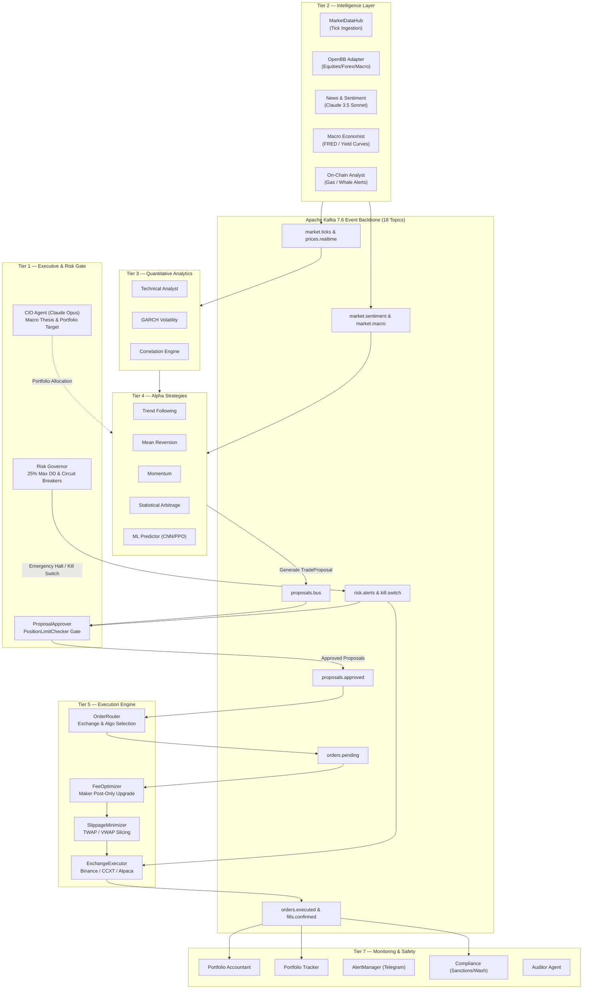
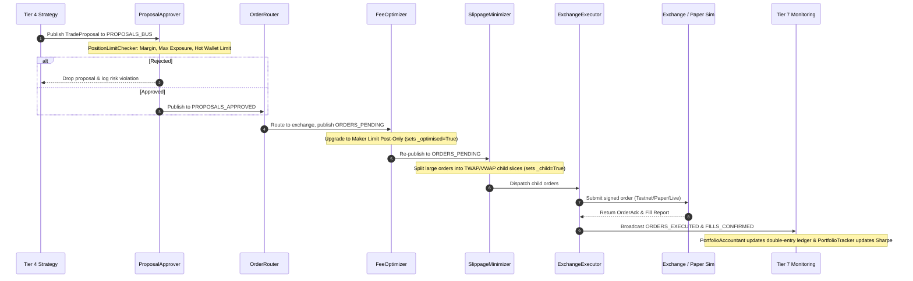

# ⚡ ALGHREST — Autonomous Multi-Agent Algorithmic Trading & Quantitative Research Platform

<div align="center">

[](https://opensource.org/licenses/MIT)
[](https://www.python.org/)
[](https://fastapi.tiangolo.com/)
[](https://kafka.apache.org/)
[](https://redis.io/)
[](https://www.timescale.com/)
[](https://www.anthropic.com/)
[](https://openbb.co/)
[](https://react.dev/)
[](https://www.typescriptlang.org/)
[](https://github.com/astral-sh/ruff)
[](http://mypy-lang.org/)

**An enterprise-grade, distributed quantitative trading and research engine powered by 20+ specialized autonomous agents across 7 tiers, an Apache Kafka event backbone, real-time Redis state, TimescaleDB hypertable persistence, OpenBB market intelligence, and a React 18 mission control dashboard.**

[Features](#-key-features) • [Architecture](#-system-architecture) • [Agent Fleet](#-the-7-agent-tiers) • [Execution Pipeline](#-trade-execution-pipeline) • [Quick Start](#-quick-start) • [Dashboard](#-mission-control-dashboard) • [Risk & Safety](#-risk-rails--safety-guardrails) • [Documentation](#-documentation)

---

</div>

## ⚠️ CRITICAL SAFETY NOTICE & REGULATORY DISCLAIMER

> [!WARNING]
> **READ CAREFULLY BEFORE OPERATION**
>
> * **Educational and Research Use Only:** ALGHREST is a quantitative research platform, backtesting framework, and paper-trading simulation environment. It does **NOT** constitute financial, investment, or legal advice.
> * **Default Mode is Paper Trading:** The system refuses real order submissions unless `ENVIRONMENT=live` is explicitly set in `.env`. By default, it operates strictly in `ENVIRONMENT=paper_trading` with `BINANCE_TESTNET=true`.
> * **Hardcoded Risk Rails:** Max risk per trade is hard-capped at **1.0%** of equity. Any strategy suffering **5 consecutive losses** is automatically paused. Maximum drawdown triggers an immediate **25% portfolio circuit breaker**.
> * **DeFi Safety Lock:** Tier 6 DeFi agents (`yield_farmer`, `dex_arbitrageur`, `mev_hunter`, `bridge_strategist`) are experimental skeletons with mock logic. Keep `ENABLE_DEFI_AGENTS=false` at all times. Enabling them with real capital will result in capital loss.
> * **No Liability:** Past simulation or backtest performance does not guarantee future results. The authors and maintainers assume no liability for financial losses incurred.

---

## 🌟 Key Features

* **🧠 Multi-Tier AI Reasoning:** Anthropic Claude 3.5 Opus acts as the high-level **CIO (Chief Investment Officer)** defining strategic portfolio allocation and macro theses, while Claude 3.5 Sonnet conducts continuous NLP news sentiment and geopolitical analysis.
* **⚡ 20+ Autonomous Trading Agents:** Specialized quantitative agents operating asynchronously across 7 distinct operational tiers — from macro intelligence and on-chain ingestion to statistical arbitrage and TWAP/VWAP execution.
* **📡 Event-Driven Microservices Fabric:** Built on an **Apache Kafka 7.6 (3-broker cluster)** messaging backbone handling 18 dedicated topics, backed by **aiokafka** and isolated SASL/SCRAM authentication.
* **💾 Ultra-Low Latency State & Persistence:** **Redis 7** provides sub-millisecond shared state, active price locks (60s TTL), and distributed kill switches; **TimescaleDB (PostgreSQL 16)** stores multi-asset OHLCV hypertables, tick logs, and trade accounting.
* **📊 OpenBB Platform SDK Integration:** Native asynchronous adapter pulling equities, crypto, forex, and FRED macroeconomic time series with intelligent multi-provider failover, synthetic spread generation, and automated database ingestion.
* **🛡️ Zero-Bypass Risk Rails:** Every proposal must pass through the deterministic `PositionLimitChecker` and `RiskGovernor` gate. The distributed Redis **Kill Switch** halts all trading and retries cancel operations across all active exchanges in milliseconds.
* **🤖 Deep Learning & Reinforcement Learning:** Integrated ML inference subsystem (`src/ml/`) running on port 8080 featuring a 64-period **Candlestick CNN** for pattern classification and a **PPO Reinforcement Learning** agent for dynamic position sizing.
* **🖥️ Interactive Mission Control Dashboard:** Built with **React 18 + Vite + Tailwind CSS + Zustand**, featuring real-time quotes, dynamic portfolio exposure, interactive PnL charts, agent health topology, Kafka message flow inspector, and a comprehensive advisory research terminal.

---

## 📐 System Architecture

ALGHREST decouples intelligence, strategy generation, risk governance, and order routing into an asynchronous event loop where **agents communicate strictly through Kafka topics and Redis shared state** — there are no direct inter-agent RPC calls.



---

## 🤖 The 7 Agent Tiers

ALGHREST organizes its agents across 7 functional tiers with Prometheus metrics isolated on port `9200 + AGENT_ID`:

| Tier | Agent Name | ID | Primary Role | Tech / Model |
| :--- | :--- | :---: | :--- | :--- |
| **Tier 1: Executive** | **CIO Agent** | `1` | High-level portfolio thesis, sector bias, macro rebalancing | Claude 3.5 Opus (1h cache) |
| | **Risk Governor** | `2` | Real-time portfolio drawdown limits, circuit breaker, kill switch | Redis / Strict Math |
| | **ProposalApprover** | `3` | Pre-trade risk gate, position limit validation, margin checking | PositionLimitChecker |
| **Tier 2: Intelligence** | **MarketDataHub** | `4` | Real-time tick ingestion, normalization, multi-feed failover | ccxt / WebSockets |
| | **News Analyst** | `5` | Financial news parsing, sentiment scoring, entity impact | Claude 3.5 Sonnet (5m cache) |
| | **Macro Economist** | `6` | Macroeconomic indicator tracking (CPI, Yields, Fed Funds) | OpenBB / FRED |
| | **Geopolitics Analyst** | `7` | Global geopolitical risk tracking and supply chain disruption | LLM NLP / RSS |
| | **On-Chain Analyst** | `8` | Whale movement detection, mempool monitoring, gas tracking | Web3 / RPC |
| | **PricePublisher** | `9` | Broadcasts 60s hot-cached pricing into Redis keys `prices:{sym}` | Redis Asyncio |
| **Tier 3: Quant** | **Technical Analyst** | `10` | Moving averages, RSI, MACD, Bollinger Bands, ATR calculations | pandas-ta / TA-Lib |
| | **GARCH Volatility** | `11` | Volatility forecasting, regime detection, volatility clustering | arch / scipy |
| | **Correlation Engine** | `12` | Cross-asset correlation matrix, beta drift, cointegration tests | numpy / pandas |
| **Tier 4: Strategies** | **Trend Follower** | `13` | Multi-timeframe trend following, EMA breakouts, trailing stops | BaseStrategy |
| | **Mean Reversion** | `14` | Bollinger Band & RSI extreme exhaustion reversal signals | BaseStrategy |
| | **Momentum** | `17` | Cross-sectional momentum, Relative Strength Index ranking | BaseStrategy |
| | **Stat-Arb** | `21` | Pairs trading, cointegration z-score mean reversion | statsmodels / OLS |
| | **Breakout Strategy** | `15` | Volatility squeeze breakouts (Donchian / Keltner channels) | BaseStrategy |
| | **ML Predictor** | `16` | OHLCV window pattern classification & dynamic RL position sizing | PyTorch CNN + PPO (Port 8080) |
| | **Macro Rotator** | `34` | Sector ETF rotation based on economic cycle phase | Sector Momentum |
| | **Cross-Exchange Arb** | `22` | Spatial arbitrage between spot and derivatives order books | ccxt / L2 Books |
| **Tier 5: Execution** | **OrderRouter** | `23` | Selects optimal exchange and execution algorithm (Market/Limit/TWAP) | Smart Routing Engine |
| | **FeeOptimizer** | `24` | Maker post-only upgrades (`_optimised=True` flag) | Microstructure Engine |
| | **SlippageMinimizer** | `25` | TWAP/VWAP child order slicing (`_child=True` flag) | Optimal Execution Engine |
| | **Liquidation Guard** | `26` | Real-time margin monitoring, preventive deleveraging | Margin Health Engine |
| | **Hedge Manager** | `27` | Delta-neutral hedging, beta hedging via perpetual futures | Derivatives Engine |
| | **ExchangeExecutor** | `28` | Low-level CCXT/Binance order dispatch, cancel, fill-polling | Async CCXT / REST |
| **Tier 6: DeFi** | **Yield Farmer** | `35` | *(Skeleton/Experimental)* Liquidity pool staking optimization | Web3.py / Aave Mock |
| | **DEX Arbitrageur** | `29` | *(Skeleton/Experimental)* Uniswap / Curve pool arbitrage | Uniswap v3 SDK Mock |
| | **MEV Hunter** | `30` | *(Skeleton/Experimental)* Flashbots bundle construction & sandwich defense | Flashbots SDK Mock |
| | **Bridge Strategist** | `31` | *(Skeleton/Experimental)* Cross-chain liquidity routing | Bridge Protocols Mock |
| **Tier 7: Monitoring** | **PortfolioAccountant**| `36`| Double-entry ledger accounting, real-time cash balance, equity | TimescaleDB Ledger |
| | **PortfolioTracker** | `37` | Real-time Sharpe, Sortino, Calmar, underwater drawdown curves | quantstats |
| | **Alert Manager** | `38` | Telegram broadcast bot with trade cards and Arabic UI support | python-telegram-bot |
| | **Compliance Officer** | `32` | Wash trade prevention, self-cross prevention, sanctions check | Regulatory Rulebook |
| | **Auditor Agent** | `33` | Independent state consistency auditor, trade ledger verification | SQL Invariant Auditor |

---

## ⚡ Trade Execution Pipeline

The execution path enforces multi-stage validation, post-only fee optimization, and algorithmic order slicing before reaching any exchange:



---

## 🚀 Quick Start

### 1. Prerequisites

* **Operating System:** Linux, macOS, or Windows 11 (WSL2 recommended)
* **Python:** `3.12+` with [Poetry](https://python-poetry.org/)
* **Node.js:** `v18+` or `v20+` with `npm`
* **Docker & Docker Compose:** Installed and running (for Kafka, Redis, TimescaleDB)
* **TA-Lib Binary:**
  * **Ubuntu/Debian:** `sudo apt-get install -y ta-lib`
  * **macOS:** `brew install ta-lib`
  * **Windows:** Download wheel from [Gohlke](https://www.lfd.uci.edu/~gohlke/pythonlibs/#ta-lib)

---

### 2. Fast Clone & Setup

```bash
# 1. Clone repository
git clone https://github.com/mohammed-khachachi/alghrest.git
cd alghrest

# 2. Install Python dependencies with Poetry
poetry env use 3.12
poetry install --with backtesting

# 3. Configure environment file
cp .env.example .env
chmod 600 .env
```

Ensure `.env` contains:
```ini
ENVIRONMENT=paper_trading
BINANCE_TESTNET=true
OPENBB_ENABLED=true
OPENBB_FALLBACK_TO_MOCK=true
ENABLE_DEFI_AGENTS=false
SYSTEM_CAPITAL_USD=10000
```

---

### 3. Spin Up Infrastructure Stack

Launch the 3-broker Kafka cluster, Redis, and TimescaleDB:

```bash
docker compose up -d
docker compose ps
docker compose logs kafka-init   # Verify all 18 Kafka topics created successfully
```

---

### 4. Run the Core Stack

You can launch the complete paper-trading system in 3 terminal tabs:

#### **Terminal 1: FastAPI Backend (Port 8000)**
```bash
poetry run python -m api.main
```

#### **Terminal 2: Core 8-Agent Paper Fleet**
```bash
poetry run python scripts/run_paper_fleet.py
```

#### **Terminal 3: React 18 Mission Control Dashboard (Port 5173)**
```bash
cd dashboard
npm install
npm run dev
```

Open your browser at **[http://localhost:5173](http://localhost:5173)** to access the live Mission Control Dashboard.

---

### 💡 Lightweight Mode (Instant UI Preview, Zero Infrastructure)

Want to explore the dashboard and charts without starting Docker, Kafka, or TimescaleDB? Run the built-in mock server:

```bash
# Terminal 1: Run mock server (fakes all 36+ agents & live market quotes)
poetry run python -m api.mock_server

# Terminal 2: Run dashboard
cd dashboard && npm run dev
```

---

## 🖥️ Mission Control Dashboard

The frontend is an institutional-grade trading workstation built in React 18:

* **📈 Overview:** Real-time equity curve, portfolio allocation by asset class, daily PnL, cash vs. exposure ratios.
* **🤖 Agents Surface:** Interactive topology map displaying all agents, status badges (running/paused/halted), Prometheus latency, and heartbeat recency.
* **📊 Holdings & Quotes:** Unified market quote table backed by OpenBB SDK with live polling every 3 seconds across stocks, crypto, and FX.
* **🛡️ Risk & Exposure:** Value-at-Risk (95% / 99% VaR), asset correlation heatmaps, max drawdown gauges, and position concentration bars.
* **📡 Kafka Inspector:** Live visualization of all 18 Kafka topics, message throughput rates, consumer group lags, and dead-letter queues.
* **🔬 Research Terminal:** Integrated deep-dive workspace (OpenTerminal platform) with multi-timeframe charts, technical indicators, and automated PDF briefing export.
* **🌐 Bilingual Interface:** Native English and Arabic (RTL) support throughout the entire interface.

---

## 🛡️ Risk Rails & Safety Guardrails

Risk governance in ALGHREST is **deterministic, non-negotiable, and strictly enforces pre-trade gates**:

| Safety Guardrail | Limit / Rule | Enforced By | Action on Breach |
| :--- | :--- | :--- | :--- |
| **Max Trade Risk** | `1.0%` of portfolio equity | `BaseStrategy.__init__` | Proposal rejected before bus dispatch |
| **Consecutive Losses** | `5` consecutive losses | `BaseStrategy.record_loss` | Strategy auto-paused for review |
| **Max Drawdown** | `25.0%` portfolio drawdown | `RiskGovernor` | Triggers circuit breaker; liquidates open positions |
| **Hot Wallet Ceiling** | `≤ 5.0%` of total capital | `PositionLimitChecker` | Rejects on-chain transfers exceeding limit |
| **Emergency Kill Switch** | Sub-second distributed stop | `kill_switch.py` via Redis | Cancels all tracked orders; halts strategy loop |
| **Environment Check** | `ENVIRONMENT=paper_trading` | `ExchangeExecutor` | Blocks real exchange orders with hard exception |

### Distributed Kill Switch Flow
1. Operator or Risk Governor triggers kill switch via Dashboard or `scripts/demo_kill_switch.py`.
2. Redis broadcasts `KillSwitchEvent` across the `risk.alerts` Kafka topic.
3. `ExchangeExecutor` intercepts the alert and immediately invokes `connector.cancel_order()` for every active order.
4. Failed cancellations remain tracked for automated retry until confirmed dead.

---

## 🧪 Testing & Verification

ALGHREST maintains strict test quality standards with a **70% coverage requirement**:

```bash
# Run fast unit tests
poetry run pytest -m unit

# Run unit tests with HTML coverage report
poetry run pytest -m unit --cov=agents --cov=core --cov-report=html

# Run integration tests (requires Docker compose stack up)
poetry run pytest -m integration

# Run backtesting validation suite
poetry run pytest -m backtest

# Code formatting & strict type checking
poetry run ruff check .
poetry run black --check .
poetry run mypy src/agents/ src/core/
```

### Backtest Validation Thresholds (Tier 4 Gate)
Before any strategy is promoted to paper or live trading, it must pass all 8 validation gates:
* Minimum **5 years** historical data.
* Minimum **50 trades/year**.
* In-Sample (IS) Sharpe Ratio **≥ 1.0**.
* Walk-Forward Out-of-Sample (OOS) Sharpe **≥ 0.8**.
* Maximum Drawdown **< 25%**.
* Profit Factor **≥ 1.3**.
* Walk-Forward Efficiency **≥ 60%**.
* Monte Carlo Probability of Ruin **< 1%**.

---

## 📊 24-Hour Stability & Soak Testing

To ensure zero memory leaks, rock-solid agent heartbeats, and uninterrupted Kafka message delivery, run the automated 24-hour stability harness:

```bash
# Single dry-run probe
poetry run python scripts/stability_monitor_24h.py --once

# Start full 24-hour soak test
poetry run python scripts/stability_monitor_24h.py --interval 60 --openbb-interval 600 --duration 86400
```

Results, latencies, and process RSS metrics are logged continuously to `artifacts/stability-test/stability_24h.jsonl` and visualized in `status.json`.

---

## 🛠️ Technology Stack

| Domain | Technologies |
| :--- | :--- |
| **Language & Runtime** | Python 3.12, asyncio, uv / Poetry |
| **Data Contracts** | Pydantic v2, dataclasses |
| **Messaging & Streaming**| Apache Kafka 7.6 (3 brokers), `aiokafka`, SASL/SCRAM-SHA-512 |
| **State & In-Memory** | Redis 7, `redis-py` (asyncio) |
| **Persistence** | TimescaleDB (PostgreSQL 16), `asyncpg`, SQLAlchemy Core |
| **AI & NLP** | Anthropic Claude 3.5 Opus (CIO) & Sonnet (Analyst), Prompt Caching |
| **Machine Learning** | PyTorch, Stable-Baselines3 (PPO), torchvision, FastAPI (Port 8080) |
| **Market Data** | OpenBB Platform SDK v4, CCXT, Yahoo Finance, FRED API |
| **Quantitative Math** | NumPy, SciPy, pandas, pandas-ta, TA-Lib, statsmodels, arch (GARCH) |
| **Dashboard UI** | React 18, Vite, TypeScript, Tailwind CSS, Zustand, TanStack Query |
| **Observability** | Prometheus (ports `9200-9240`), Grafana, Structlog, psutil |

---

## 📁 Repository Structure

```
alghrest/
├── artifacts/                  # Model weights (CNN/PPO), stability logs, research artifacts
├── dashboard/                  # React 18 + Vite + Tailwind Mission Control Dashboard
│   ├── src/
│   │   ├── components/         # Charts, agent topology, risk gauges, layout
│   │   ├── pages/              # Overview, Agents, Positions, Risk, Kafka, Terminal
│   │   └── lib/                # useLiveQuotes hook, API client, Zustand stores
│   └── tests/                  # UI unit and conformance tests
├── docs/                       # Architectural specifications and integration guides
├── infra/                      # Docker, Kubernetes, Terraform, and Kafka initialization
│   ├── init/                   # kafka-init.sh (creates 18 Kafka topics)
│   └── docker-compose.yml      # 37-service complete infrastructure stack
├── run_agent.py                # Universal CLI runner for all autonomous agents
├── scripts/                    # Fleet supervisors, kill switch demos, stability harnesses
│   ├── run_paper_fleet.py      # Core 8-agent paper trading fleet launcher
│   ├── stability_monitor_24h.py# 24-hour soak test and health probe monitor
│   └── demo_kill_switch.py     # Interactive emergency kill switch CLI (Arabic/English)
├── src/
│   ├── agents/                 # Autonomous agents organized across 7 tiers
│   │   ├── tier1_executive/    # CIO Agent, Risk Governor, Proposal Approver
│   │   ├── tier2_intelligence/ # MarketDataHub, News Analyst, Macro Economist
│   │   ├── tier3_quant/        # Technical Analyst, GARCH, Correlation Engine
│   │   ├── tier4_strategies/   # Trend, Mean Reversion, Momentum, ML Predictor
│   │   ├── tier5_execution/    # Order Router, Slippage Minimizer, Exchange Executor
│   │   ├── tier6_defi/         # Yield Farmer, DEX Arb, MEV Hunter (Skeletons)
│   │   └── tier7_monitoring/   # Portfolio Accountant, Tracker, Alert Manager
│   ├── api/                    # FastAPI production app and lightweight dev mock server
│   ├── backtesting/            # Event-driven backtesting engine & walk-forward optimizer
│   ├── connectors/             # OpenBB adapter, CCXT connectors, paper exchange engine
│   ├── core/                   # StateManager (Redis), MessageBus (Kafka), Risk Engine
│   └── ml/                     # Candlestick CNN, RL Position Sizer, Inference Server
└── tests/                      # Unit, integration, and backtesting test suite
```

---

## 📄 License & Attribution

This project is licensed under the **MIT License** — see the [LICENSE](LICENSE) file for details.

* **OpenBB SDK:** [OpenBB.co](https://openbb.co/)
* **Anthropic Claude:** [Anthropic.com](https://www.anthropic.com/)
* **Apache Kafka:** [Kafka.apache.org](https://kafka.apache.org/)

---

<div align="center">
<b>ALGHREST Quantitative Systems</b> • Built for precision, governed by strict mathematical risk rails.
</div>
