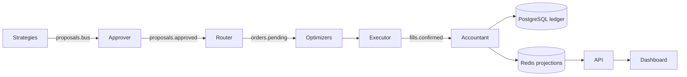

# Architecture

ALGHREST is an event-driven application in a repository with independently developed dashboard and research projects. The `src/` layout separates distributable Python code from operator scripts, experiments, documentation, and generated files. Package names and Kafka contracts remain stable.

Runtime modes are explicit: `python -m scripts.runtime research|paper|full plan`.
Research is requested on demand in its isolated process; paper uses the existing
seven-agent supervisor; full selects the larger deployment. See
[runtime boundaries](decisions/0002-runtime-boundaries.md) and
[operating modes and measurements](maintenance/runtime-efficiency.md).

## Responsibilities and dependency direction

| Location | Owns | Boundary |
|---|---|---|
| `src/core/` | Models, settings, ledger, execution persistence, risk, messaging, shared monitoring data | Must not import agents, API, connectors, ML, or backtesting |
| `src/connectors/` | Exchange and market-data adapters | May use core; must not import agents or API |
| `src/agents/` | Lifecycle and tier-specific orchestration | Uses core/connectors; agents exchange messages, not direct calls |
| `src/api/` | REST/WebSocket delivery and development mock service | Adapts shared state for clients; does not own accounting truth |
| `src/backtesting/` | Simulation and validation | Must not import runtime agents or API |
| `src/ml/` | Training and inference | Separate process; must not import runtime agents or API |
| `dashboard/` | Browser presentation | Consumes API/WebSocket contracts |
| `scripts/` | Operator/developer commands | Uses installed application packages |
| `infra/` | Service definitions, SQL migrations, monitoring | No Python business rules |
| `research/` | Independent studies, reference material, research tests | Separate environments; not imported by the runtime |
| `examples/` | Static demonstrations | Not part of the running application |
| `artifacts/` | Model weights and checkpoints | Local assets; not Python packages or image build inputs |

`python scripts/check_architecture.py` enforces the static Python import boundaries above, including imports inside functions. For the advisory graph, it follows transitive local imports and package initializers, resolves literal dynamic imports, and rejects unresolved dynamic imports and external wildcard imports. It does not sandbox arbitrary Python reflection or prove the absence of direct runtime calls. Runtime capability guards provide a separate boundary. The check runs in CI and has positive/negative regression tests.

Monitoring topic metadata lives in `core.kafka.topics`, so the Kafka metrics collector does not import the WebSocket API. Topic identifiers remain owned by `core.data.models.KafkaTopic`; the monitoring list retains the existing client behavior.

## Runtime flow

The diagram summarizes message flow; components communicate through Kafka/Redis. Accounting and execution recovery details are in [accounting](accounting.md) and [execution recovery](execution-recovery.md). Ledger opening balances are explicit imports. Credentials, balances, and risk thresholds are not derived from this directory structure.

## Packaging and configuration

- `pyproject.toml` declares six packages with `from = "src"`. `poetry install` or `pip install --no-deps -e .` installs them without changing their import names.
- `run_agent.py` remains at the repository root as the stable launcher used by Compose. Use `python -m api.mock_server` and `python -m ml.inference.server` for those services.
- Start commands from the repository root so `.env` and relative artifact paths have a predictable base. Tests validate package imports from outside the checkout too.
- `Dockerfile` installs the application and copies only runtime launchers and required infrastructure files. `.dockerignore` excludes local credentials, environments, research, examples, dashboard sources, tests, and artifacts.
- ML training writes to `artifacts/models/`; checkpoints default to `artifacts/checkpoints/`. Preserve explicit paths in existing environment settings when migrating externally stored models.
- Dashboard dependencies belong to `dashboard/package.json`; HMM dependencies belong to its own project. Root formatter/linter discovery excludes independent research and examples.

## Where new work belongs

Extend an existing package before creating a new top-level directory. Add shared contracts to core, external I/O adapters to connectors, and workflow orchestration to agents. Keep reference studies under research until an explicit, tested adapter is designed. Put operator procedures under `docs/runbooks/` and decisions under `docs/decisions/`. Keep retired implementations and raw historical outputs in the private archive snapshot; retain current verification records separately from application code.

Infrastructure scaffolds and experimental agents keep their existing maturity level. Moving files does not make an unverified component production-ready.

## Manual research boundary

`core/advisory` contains pure analysis and evaluation rules. `connectors/advisory`
reads public sources and writes a separate SQLite store. `api/advisor.py` runs
on loopback 8011, independently of the trading API and Redis/PostgreSQL. The
dashboard lazy-loads `/assistant` and uses only `/assistant-api` there. The optional
Kafka consumer has its own group and an intelligence-topic allowlist, with no
producer or order path. See [manual assistant](manual-assistant.md).

## Advisory operating profile

`OPERATING_PROFILE=earn2trade_tcp25` is independent of `ENVIRONMENT`. The only
execution-capable profile is `general`, retained as the compatibility default.
Unknown configured profiles are rejected during settings validation; unknown
values introduced through unvalidated internal copies also deny execution.

The advisory profile rejects legacy agent startup and all legacy producer writes.
It also guards executor initialization/submission, credential-bearing exchange
connections, broker creates/cancels, paper order matching/cancellation, recovery
order processing/outbox publication, and trading API startup. The checks precede
external side effects, including when objects already exist or collaborators have
been replaced. Closing clients remains available for cleanup.

The isolated assistant remains available and keeps its intelligence consumer.
Research Compose fixes the advisory profile and omits the trading `.env`; full
Compose propagates the selected profile to every agent. The runtime launcher
refuses paper/full startup under the advisory profile before any subprocess.
Choose the profile before process startup; changing environment variables does
not alter an already constructed Settings object.

This boundary does not validate trading edge, make research scenarios approved
recommendations, or certify TCP25 readiness. See the
[TCP25 migration evidence](maintenance/tcp25-migration.md).
