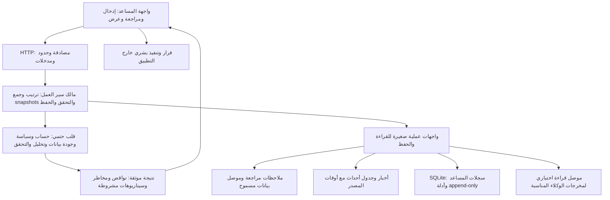

## Capability mission registry — VERIFICATION PASSED; DOCKER RESTORATION PENDING (2026-10-13T09:50:34.090864+00:00)

The approved **23 paths** are implemented: five existing files changed, three new source/test files and fifteen archive/evidence files. Exact paths and before/after identities are in `artifacts/advisory-capability-registry-v1/source-manifest.json`; commands, diagnostics, replay and containment results are in `verification.json`. The five originals were archived byte-for-byte before edits and tests.

A single static mission registry covers all **40 non-package agent/helper source files**: **25 PLANNED, 5 CONTEXT_ONLY, 2 SUPPORT_ONLY and 8 EXCLUDED**. Each entry names its intended report role, required inputs, planned output and acceptance criteria. These states describe a migration contract, not observed runtime or completed adaptation. The existing five read-only context topics remain unchanged. Unsuitable on-chain and cross-exchange analysis, execution, copying and all four DeFi roles are explicitly excluded; suitable execution-path calculations are only candidates for later isolated extraction.

Authenticated `GET /assistant-api/capabilities` reads current source identities without importing or starting agents, using the existing middleware. Its registry always states `NOT_OBSERVED`, `NOT_ASSESSED`, `all_agents_integrated=false`, `trade_permitted=false` and `execution_enabled=false`. Missing, redirected, unmapped or changed source evidence is rejected; stale envelopes are preserved rather than patched. Renamed/duplicated roles, reconstructed positive flags and hypothetical confirmation cannot convert the catalog to a qualified signal. Verification repeats whole-file source checks per request; there is no persistent verification cache. Pre-existing API function bodies/signatures and test fixtures are unchanged; financial arithmetic, briefing evidence fields, the MES/MNQ-only **20 Micro total cap**, current **$1,100 daily-loss setting**, and official TCP50 blocked eligibility remain unchanged.

Verification: **2746 full-suite tests passed, zero failures/errors/skips, 562 warnings; coverage 84.47% against the unchanged 70% gate**. Focused tests: **400 passed, zero skips, 36 warnings**, overlapping with the full suite and not added to it. Ruff, Black check, isort check, strict MyPy (130 source files), all six architecture packages and TypeScript passed. isort's 13 configured file exclusions are disclosed. Dashboard source is unchanged; no new frontend/browser functionality was introduced or certified. Initial focused tests stalled in sandbox TestClient setup; a bounded 20-second diagnostic failed there, and the same API case passed outside the sandbox in 1.09 seconds. The focused and full receipts are the final successful runs; original diagnostics remain in /tmp and their details/commands are preserved in this receipt.

Fresh public verification passed for existing futures run/edge/walk envelopes with path replay, strict source hashes and exact comparison. The three legacy TCP25 outcomes remain separately **PASS, FAIL and CENSORED — SYNTHETIC MECHANICS ONLY**. Three unchanged briefing examples reopened and independently replayed successfully; their source identity set is unaffected, so they were not regenerated or rewritten. The new registry was serialized, reopened and independently verified. The inventory is a code/migration map, not trading-edge evidence.

All **1570 prior public artifact files**, five original archives and **137 existing htmlcov/.coverage files** were preserved. The monitored public-file inventory records only the approved 23 paths as changed/created. Credentials, private root data, private dependency/tool directories and database sidecars are excluded; this public inventory is not a claim of byte-level preservation of private mutable databases. Coverage data, explicit HTML destination `/tmp/alghrest-capability-registry/htmlcov`, JSON/XML reports, test temporary files, Hypothesis storage and tool caches stayed in /tmp; bytecode and pytest cache writes were disabled. Published JUnit copies remove hostname attributes and redact userinfo in one synthetic URL parameter from an existing redirect-denial test; originals remain in /tmp. The first independent secret-pattern scan flagged that synthetic parameter, which was redacted before final re-verification. The historical htmlcov exception cannot be certified retroactively because its earlier bytes were not hashed; earlier missing SQLite WAL/SHM files remain unreconciled. This increment does not hide either limitation.

After renewed explicit user authorization, only existing isolated PostgreSQL/Redis/Kafka quality services were started, then stopped. Docker service is still active/socket active; restoring its prior inactive service state requires the user’s local sudo stop command. The automated noninteractive stop failed because a password was required; test ports15432/16379/19092 are closed. Existing assistant8011/dashboard5173 remain available and were not restarted. The new API was tested in isolated TestClient applications; the user's existing API is not certified as reloaded. No broker mutation, order/cancellation/liquidation/copying, purchase, external message, paid model call, .env edit, failed-soak restart or new holdout access occurred.

Code, tests and evidence verification passed; this capability-registry increment is not fully closed until Docker restoration is independently confirmed. It does not complete adaptation of all agents, qualify a 5m/15m strategy, resolve permitted market-data coverage, or complete forward Paper evaluations. The staged mission remains evidence-led MES/MNQ reports for human decisions; current session briefings remain WAIT/NO_TRADE. Passing probability **UNKNOWN**. The compatible broader Goal remains **BLOCKED** in the tool, with no unsupported resume or completion claimed. **Stop for human review before further implementation or deployment.** The next bounded proposal should define qualified 5m/15m conditional-analysis inputs and deterministic invalidation/target rules before adapting strategy contributions.

---

## Workflow unification — VERIFIED; review checkpoint (2026-10-13T01:56:45.552958+00:00)

The approved **33 paths** are implemented: nine existing files changed, one new application module and 23 new evidence/archive files. The exact scope, before/after identities and preservation checks are in `artifacts/architecture-workflow-unification-v1/source-manifest.json`; exact commands and results are in `verification.json`. The nine original files were archived byte-for-byte **before edits and tests**. Historical sections below describe their own dated increments.

`src/api/services/briefings.py` now owns context collection and the report workflow: capture selected reviewed observation/account revisions, collect read-only context, recheck, calculate and save. Existing HTTP functions and signatures remain compatible adapters, including `_collect_context`. No route imports another route's helper. Financial arithmetic, source clocks, serialized evidence fields, the MES/MNQ-only **20 Micro total cap** and the current **$1,100** daily-loss setting are unchanged; the later $1,200 example has not been substituted.

Root cause corrected: cancelling `asyncio.to_thread` did not stop its SQLite writer. Three deterministic before probes returned “not saved” and then committed a report. The original regression failed before the correction. A request-local commit guard now cancels/rolls back a write that has not crossed its commit decision and checks its original monotonic deadline at that decision. A commit already underway is not claimed to be interruptible: its response explicitly reports an uncertain outcome and directs the user to history. A known committed record whose display fails is reported as saved. Each request gets a fresh guard; it is neither reusable evidence nor a persistent verification cache. The existing commit-time revision checks remain inside the transaction.

Verification: **2719 full-suite tests passed, zero failures/errors/skips, 562 warnings; coverage 84.43% with the unchanged 70% gate**. Focused regressions: **74 passed**, overlapping with the full suite, not added to it. All six frontend suites passed **110 cases**. Ruff, Black check, isort check, strict MyPy (**128 source files**), six-package architecture, TypeScript and production build passed. Browser checks: **12 passed** against the actual isolated API/store, including pre-commit timeout, commit uncertainty, delivery failure, preserved selection/history, authentication and mobile layout. The mobile screenshot was inspected. Browser inputs, empty context, fixed source clock, shortened test deadline and fault barriers were synthetic instrumentation; production remains at its existing 30-second deadline. The first browser harness attempt observed an old result before the retry finished; it was corrected to await the actual POST response and re-run successfully. Its failed receipt is retained in controls; the production build retains the Browserslist age warning.

Fresh public replay passed for the existing futures **run, edge and walk** artifacts. Legacy TCP25 outcomes were independently verified and reported separately as **PASS, FAIL and CENSORED — SYNTHETIC MECHANICS ONLY**. Three briefing examples were regenerated from their exact original inputs, clocks and cost/configuration/result fields; only new IDs and current source identities differ. Old changed-source envelopes are rejected, preserved and never patched. Three new envelopes and six actual temporary saved records were independently reopened in a separate process with strict source checks and exact replay. Trade and execution permission remained false; historical age was displayed without renewing the source price time.

Only the approved paths were written in the monitored public-file inventory; previous artifacts and current htmlcov/.coverage were preserved by byte comparison. Credentials, root private data, database sidecars, dependency/tool private directories are excluded from that public inventory. Coverage data, explicit HTML destination `/tmp/alghrest-workflow-unification/htmlcov`, JSON/XML reports, test temporary files, Hypothesis storage, build/browser files and caches stayed in /tmp; bytecode and pytest cache writes were disabled. Published JUnit copies remove hostname attributes; originals remain in /tmp. The **historical htmlcov exception cannot be certified retroactively** because earlier bytes were not captured. Earlier disappeared SQLite WAL/SHM files remain unreconciled. Current preservation does not erase either limitation.

Cleanup was independently checked after the user's stop: Docker service **inactive**, socket **active**, matching its baseline; PostgreSQL/Redis/Kafka test ports and temporary API18114/UI15176 ports closed. Existing assistant8011/dashboard5173 remain available and were not restarted. Verification used isolated servers; the already-running user API has not been certified as reloaded with this change. No orders, broker mutations, purchases, external messages, paid-model calls, .env changes, failed-soak restart or new holdout access occurred.

This is engineering completion of this increment only. The report still offers **WAIT/NO_TRADE**, official TCP50 positive eligibility remains blocked, and no complete agent integration, qualified 5m/15m strategy, live-data entitlement, forward evaluation or trading edge is certified. Passing probability **UNKNOWN**. Goal tool status remains **BLOCKED**; no unsupported resume or overall completion is claimed. **Stop for human review before further implementation or deployment.** Next work needs a separate bounded scope: define qualified 5m/15m conditional analysis and acceptance evidence, then integrate only useful read-only capabilities.

---

# ALGHREST — توحيد الهندسة وخطة الانتقال

Date: 2026-10-13 UTC. Status: **target architecture researched; first bounded implementation verified for review**. This document records a staged engineering direction, not completion of the whole migration, trading readiness or passing probability.

## النتيجة والهدف

الهدف هو مساعد تقييم تمويل يمكن فهمه واختباره وتطويره: يجمع الأسعار التي يراجعها المستخدم والمصادر المسموحة والأخبار والحساب، يفحصها بقواعد واضحة، ويعرض خطة مشروطة وأسباب الانتظار والمخاطر عندما تسمح الأدلة بذلك. **المستخدم يقرر وينفّذ بنفسه**. عدد الوكلاء أو اللغات أو الخدمات ليس مقياس جودة؛ المقياس هو صحة القرار وإمكانية تفسيره وإعادة إنتاجه واستمراره داخل القيود.

اختيارنا الهندسي: **Modular Monolith للمساعد، مع Ports & Adapters وقلب حتمي للحساب والتحقق**. نبقي Python/FastAPI وReact/TypeScript، ونستخدم الوصلات الحالية بقدر الإمكان. محرك Kafka والوكلاء القديم مسار توافق منفصل؛ مساهماته المناسبة تصل إلى المساعد للقراءة فقط. نستخرج عملية مستقلة عندما تثبت القياسات حاجة لعزل العمل أو التوسع، لا لمجرد زيادة عدد الخدمات.

هذه توصية خاصة بحجم المشروع واستخدامه المحلي؛ ليست ادعاء بوجود بنية أو خوارزمية أفضل في جميع الحالات. فصل الحساب عن الواجهة والمصادر يوافق [الورقة الأصلية لـPorts & Adapters](https://alistair.cockburn.us/hexagonal-architecture)، وتوثق [إرشادات Microsoft](https://learn.microsoft.com/en-us/dotnet/architecture/modern-web-apps-azure/common-web-application-architectures) تكاليف تقسيم التطبيقات إلى خدمات. لا يستلزم الاستفادة من هذه المبادئ الانتقال إلى .NET.

## ما تحققنا منه في المستودع

الجرد شامل لملفات Python داخل `src` وملفات الواجهة، وليس مراجعة سطرية أو تدقيقًا أمنيًا لكل خوارزمية. فُحصت تعليمات AGENTS/CLAUDE، توثيق الانتقال والبنية والقرارات السابقة، الوصلات الأساسية ومالكو الحساب والتحقق، وأدلة المرحلة السابقة. يحتوي الجرد على هويات المصدر وعلاقات الاستيراد وملاحظات العمل المحلية الحالية. لم تُهمل أو تُحذف التعديلات السابقة.

| الملاحظة | الدليل الحالي | الأثر والخطوة |
|---|---|---|
| 151 ملف Python في المصدر، 30,037 سطرًا؛ ست حزم تطبيق | الجرد AST، `pyproject.toml` | نطور الوحدات الموجودة بدل إنشاء مشروع ثانٍ أو نقل كل الملفات دفعة واحدة؛ عدد الأسطر وحده ليس حكمًا على التصميم |
| طبقة `core` مستقلة عن API/موصلات/وكلاء، مع حارس استيرادات للمساعد | `scripts/check_architecture.py`؛ فحص جديد ناجح | نحافظ على اتجاه الاعتماد ونضيف القيود التفصيلية مع كل مرحلة |
| قاعدة SQLite للمساعد منفصلة عن Redis/PostgreSQL التداول | `src/connectors/advisory/storage.py`، `docker-compose.advisor.yml` | العزل الحالي أصل مفيد؛ لا ندمج القواعد لمجرد توحيد الواجهة |
| المساعد ولوحة قديمة ومحاكاة لها واجهات تشغيل مختلفة | `src/api/{advisor,main,mock_server}.py`، `dashboard/src/App.tsx` | نجعل المساعد مدخل المنتج؛ تبقى الروابط القديمة صريحة للتوافق ولا تصبح حقيقة حساب التقييم |
| جمع سياق الأخبار له helper داخل route وتستدعيه route أخرى | `src/api/routes/advisory_context.py` و`advisory_briefings.py` | المرحلة التالية تنقل ترتيب جمع الأدلة إلى مالك سير عمل واحد بواجهة صغيرة؛ HTTP يصبح محولًا فقط |
| خدمة واحدة تجمع تقارير/اختيار أسواق/مخاطر وسياسة، ومخزن يحمل سجلات مختلفة | `src/api/services/advisory.py`، `storage.py` | نُعمّق وحدات الاستخدام ذات المعنى؛ لا نضيف طبقة تمرير لكل دالة أو نفصل لمجرد طول الملف |
| بعض الموصلات تعتمد تفاصيل داخلية للمخزن | `BriefingStore` يستعمل `_evaluation` داخل معاملته | نصمم قراءة snapshot واحدة تحفظ المعاملة والمراجعة؛ لا نستبدلها بقراءات متفرقة تفتح سباقًا |
| بصمات التقرير تضم ملفات من API والتخزين، لا الحساب فقط | `src/core/advisory/briefing.py::SOURCE_FILES` | تغيير هيكلي قد يجعل أدلة قديمة مرفوضة؛ نبقي الفحص الصارم ونُجدد الأمثلة إلى وجهة جديدة من مدخلاتها الأصلية |
| تعريف الاستراتيجية المسجل الحالي يشترط `1d` | `src/core/advisory/strategies.py::StrategyDefinition` | لا نعيد تسميته إلى 5m/15m دون تعريف واختبار مناسبين |
| CrewAI/LangGraph/Celery/Ray/Qdrant/Dynaconf/Polars معلنة بلا استيراد مباشر في `src` | AST لجميع 151 ملفًا | مرشحات مراجعة dependency groups؛ هذا لا يثبت عدم استعمالها عبر plugins أو scripts أو research، فلا تُحذف تلقائيًا |
| اختبارات الواجهة توجد لكن package.json لا يعرّف أمر test، وCI الحالي لا يشغّلها | `dashboard/tests/`، `dashboard/package.json`، `.github/workflows/tests.yml` | نربط اختبار الواجهة والمتصفح ببناء قابل للتكرار في مرحلة الجودة؛ الاختبارات اليدوية ليست بوابة CI |
| وصف البنية القديم ما زال يركز على التنفيذ | `docs/architecture.md` وCLAUDE | نصحح المرجع الحالي تدريجيًا ونحفظ وثائق التنفيذ كوثائق لمسار التوافق؛ لا نحذف التاريخ |

**مكتمل هندسيًا في الخطوة الحالية:** توحيد تعريفات التنقل، المدخل الافتراضي للمساعد، فصل قائمته وعلامات حالته عن لوحة التداول القديمة، حفظ أدلة التغيير والتحقق. **مقترح/غير منفذ بعد:** توحيد مالك جمع الأدلة، تفكيك مخزن السجلات بواجهات snapshots، ربط كامل الوكلاء، قياسات أداء التطبيق، تغيير مجموعات الاعتمادات، خوارزمية مؤهلة لـ5m/15m، وإكمال تجارب أمامية.

## البنية المستهدفة

السهم هو علاقة استعمال أو تدفق بيانات؛ لا يعني أن `core` يستورد الموصلات. القلب يستقبل قيمًا صريحة ويعيد نتائج، ولا يملك شبكة أو بيانات دخول أو مسار إرسال أوامر. طبقة الاستخدام تركّب الوصلات وتحدد الساعة والمهلة والإلغاء. لا يوجد منفذ تنفيذ أوامر داخل تركيب المساعد.

| الوحدة المنطقية | مالكها الحالي/المستهدف | واجهتها المفيدة |
|---|---|---|
| تعريف أداة وعقد وساعة ونسخة | `core/advisory/models.py`, `observations.py`, `data.py` | snapshot صريح مع العقد وأوقات المعرفة والاكتمال |
| الحساب وقواعد المستخدم | `evaluation.py`, `account.py`, `user_policy.py`, `user_risk.py` | قيم حساب حتمية ومراجعة مرتبطة؛ لا حساب مكرر في المتصفح |
| سياسة شركة/برنامج | `policy.py`, `risk.py` | تأهيل منفصل بالقواعد وأدلتها؛ قواعد المستخدم لا تُقدَّم كاعتماد رسمي للشركة |
| تحليل وإدارة بحث | `analysis.py`, `core/strategy_signals.py` | نتيجة قابلة لإعادة الحساب من بيانات محددة؛ متطلبات بيانات معلنة |
| تأهيل استراتيجية وتجربة | `strategies.py`, `selection.py`, `backtesting/` | خطة وتكاليف وسجل محاولات وfolds وholdout معزول |
| تحقق الأدلة | `_futures_evidence.py` والـvalidators الحالية | إعادة مسار وفحص مصادر ومقارنة دقيقة، مع إعادة استخدام داخل الطلب فقط |
| تقرير جلسة | `briefing.py` | مدخلات مرتبطة ونتيجة WAIT/NO_TRADE الحالية؛ ليست إذن تداول |
| ترتيب العمل | `api/services/`، تركيب في `api/advisor.py` | طلب واحد يجمع snapshots ويعيد التحقق عند الحفظ ويرجع سجلًا واضحًا |
| قراءة/حفظ مصادر | `connectors/advisory/` | تبديل adapter دون نقل الحساب أو السياسة إليه |
| الواجهة | `dashboard/src/components/advisory/` و`lib/` | مراجعة المدخلات وحماية الردود المتأخرة وعرض مصدر كل رقم |

الأسماء هنا خريطة مسؤوليات، وليست موافقة على نقل كل ملف إلى مجلد جديد. تبقى الحزم الست ومسارات الاستيراد العامة ثابتة خلال الانتقال. أي استخراج يكون داخل الحزمة المالكة مع اختبار عبر الواجهة؛ لا حزمة `utils` عامة ولا framework داخلي يضاعف الملفات.

## ترتيب عمل واحد

1. تحقق من الطلب والعقد والنسخة والساعة والصلاحية.
2. اقرأ الملاحظة المراجعة والحساب كوحدات snapshot مرتبطة بمراجعاتهما.
3. اجمع المصادر المستقلة بتوازٍ محدود وميزانية زمن واحدة، مع فشل جزئي موضح.
4. اربط الأدلة بما كان معروفًا في وقت التقييم؛ لا تجدد وقت السعر عند جلب خبر أو إعادة فتح تقرير.
5. طبق الجودة والاكتمال وحالة الأحداث والحساب، ثم الحساب الحتمي المناسب لما توفر فعلًا.
6. أعد فحص المراجعات داخل معاملة الحفظ؛ ارفض التغير المتزامن بدل حفظ خليط قديم/جديد.
7. احفظ نتيجة append-only كاملة المدخلات والتكاليف والهوية والأسباب؛ إعادة الفتح تتحقق من المصدر وإعادة الحساب.

لا نضيف outbox إلى عملية SQLite محلية وحيدة. إن احتجنا لاحقًا نشر أحداث موثوقة بين عمليات، يُستخدم transaction + outbox + IDs ثابتة ومعالجة idempotent، مع اختبارات الانقطاع والتكرار. يشرح [AWS transactional outbox](https://docs.aws.amazon.com/prescriptive-guidance/latest/cloud-design-patterns/transactional-outbox.html) مشكلة الكتابة إلى قاعدة ثم نشر رسالة والضرورة المحتملة لتحمل التكرار. ليس ذلك ضمان exactly-once عامًّا.

## الخوارزميات: ما يفيد الهدف وما يحتاج دليلًا

لا يوجد دليل يحدد «أفضل خوارزمية» لتحقيق $3,000 في اختبار بعينه. نختار baseline صغيرًا قبل المقارنة، ونسجل محاولات الاختيار، ولا نُشغّل خوارزمية تحتاج سلسلة شموع على لقطات أسعار فقط.

| المجال | المنهج المناسب | شرط القبول |
|---|---|---|
| أسعار من لقطات | parsing صارم، مراجعة بشرية، مقارنة فريمات صالحة، أوقات مستقلة | تبقى user-reported؛ لا نختلق OHLCV أو Bid/Ask أو تنفيذًا بين الصور |
| جودة البيانات | عقد فعلي، اكتمال الشمعة، gaps/duplicates/corrections، as-of/version | مصدر مسموح ومدخلات كاملة أو حالات UNKNOWN واضحة |
| أخبار وأحداث | dedup، مصدر ووقت نشر/توفر، ربط بالأداة، جدول قابل للتحقق | فشل مصدر أو نقص تغطية لا يتحول إلى «لا خطر»؛ عنوان خبر ليس توقع سعر معايرًا |
| اتجاه/تقلب/مستويات | إعادة استخدام EMA/ATR/RSI/المستويات الموجودة حيث تكفي البيانات | عدد شموع ومواصفات وseed/config معلنة، دون حساب مؤشر من آخر سعر وحده |
| استراتيجيات | قواعد دخول وإلغاء وهدف وامتناع بسيطة ومحددة مسبقًا | مقارنة زمنية ببيانات لم تُستخدم في الاختيار، مع نفس التكاليف والعقد والأفق |
| حساب المخاطر | Decimal وقيمة tick/عقد ومخاطر وقف وتكاليف وحدود الحساب | المحافظة على سقف20 Micro، احتساب المراكز والأوامر حسب القاعدة الحالية، لا تغيير الأرقام في استخراج هيكلي |
| عدم اليقين | bootstrap زمني/كتلي للبيانات التابعة كما في الأدوات الحالية | حجم عينة وشروط block وseed واضحة؛ تغطية غير معايرة تبقى غير معايرة |
| تدريب نماذج | معالجة fit على التدريب فقط، walk-forward، gaps من آفاق features/labels، holdout أخير معزول | كشف التسرب وتسجيل الاختيار؛ [TimeSeriesSplit](https://scikit-learn.org/stable/modules/generated/sklearn.model_selection.TimeSeriesSplit.html) أداة تقسيم زمني وليست تنفيذًا كاملًا لـfinancial purging |
| نسب الثقة | reliability/calibration على جزء زمني مستقل عند كفاية البيانات | ثقة نموذج لا تعني احتمال اجتياز؛ [توثيق calibration](https://scikit-learn.org/stable/modules/calibration.html) يوضح متطلبات تقييم المعايرة |
| محاكاة تقييم | إعادة أحداث داخل اليوم مع العمولات والمراكز والأوامر وقواعد معلنة | PASS/FAIL/CENSORED منفصلة؛ شموع15m وحدها قد لا تكشف تجاوزًا بين الإغلاقات |

تمنع [إرشادات data leakage](https://scikit-learn.org/stable/common_pitfalls.html) تأثير بيانات الاختبار في التدريب والتحويلات. ويشرح [بحث backtest overfitting الأصلي](https://www.davidhbailey.com/dhbpapers/backtest-prob.pdf) أثر اختيار الفائز من محاولات كثيرة. تطبيق هذه المبادئ يحتاج بيانات وقياسات فعلية؛ هذا المستند لا ينفذ تدريبًا أو tuning أو وصولًا جديدًا إلى holdout.

## اللغات والتخزين والتوسع

- **Python** يبقى مالك الحساب والبحث والتنسيق الحالي. async مفيد لانتظار I/O، وليس برهانًا على تسريع عمل CPU؛ [FastAPI concurrency](https://fastapi.tiangolo.com/async/) و[Python profiling](https://docs.python.org/3.12/library/profile.html) أساس اختيار التحسين بالقياس.
- **TypeScript/React** يبقيان طبقة العرض والتحقق من شكل الاستجابات. الحساب المالي النهائي في القلب؛ قيم الأموال تبقى سلاسل Decimal في العقود، وليس تحويلًا عامًا إلى float.
- **Rust أو Go** ليسا قرارًا مقبولًا بعد: لا يوجد profile يثبت اختناقًا تحتاجه هذه اللغات. إن ثبت لاحقًا، نستخرج نواة محسوبة واحدة أو عاملًا مستقلًا بواجهة محدودة ونختبر التطابق العددي والتكلفة التشغيلية قبل التوسع.
- **SQLite** مناسب حاليًا لمخزن المساعد المحلي. نضيف migrations/schema version واختبارات recovery/lock عندما نغير التخزين، ولا نفترض أن تشغيل عدة workers آمن لأن قاعدة البيانات موجودة. PostgreSQL/TimescaleDB يظلان مالكي المحرك القديم؛ النقل يحتاج workload وسببًا واضحين.
- **Kafka** اختياري لقراءة مخرجات مناسبة من fabric القديم. لا يصبح شرطًا لفتح المساعد أو مراجعة صورة. لا نضيف Kubernetes أو مجموعة collectors أو Redis للمساعد لمجرد شعار التوسع.
- **اعتمادات البرامج** تُراجع باستخدام استيرادات المصدر والأدوات والاختبارات والحزم الديناميكية، ثم تُنقل إلى groups ويُجدد lock في نطاق مستقل. لا ترقيات جماعية أو حذف مبني على بحث نصي فقط.

تعني القابلية للتوسع أن الوحدة يمكن استبدالها وقياسها واختبارها دون لمس الحسابات الأخرى؛ ليست الحاجة إلى تشغيل جميع الوكلاء دائمًا. نبدأ بـstructured logs وmetrics محلية تصف عمر المدخلات ووقت الجلب والتحقق وعمق الطابور والذاكرة والأخطاء، دون تسجيل المفاتيح. [OpenTelemetry](https://opentelemetry.io/docs/concepts/signals/) مرجع للإشارات الثلاث؛ لم نثبت collector أو ندّعِ قياس أداء شامل في هذه المرحلة.

## سياسة الأدلة والانتقال

كل increment يسجل هويات الملفات قبل التعديل، وأرشيف الملفات القائمة، والنطاق، وأوامر التحقق ونتائجها. تبقى الأدلة القديمة والمراسلات والبيانات الخاصة في مكانها. لا إعادة كتابة لبصمة قديمة لتبدو متوافقة مع المصدر الجديد. إذا تغير ملف داخل source-hash list، يُرفض غلافه القديم وفق السلوك الحالي وتُولد نسخة جديدة من المدخلات الملتقطة نفسها، مع مقارنة القيم العددية والحقول والتكاليف. التحقق بتحميل تاريخ قديم من الكود خارج النطاق.

إعادة استخدام تحقق outcomes/edge/uncertainty/folds تكون داخل الطلب الجاري فقط؛ كل طلب مستقل يعيد public path replay وsource checks والمقارنة الدقيقة. cache جلب خبر محدودة لا تعني cache تحقق دائمًا. إعادة فتح تقرير لا تجعل سعره جديدًا. [W3C provenance](https://www.w3.org/TR/prov-overview/) و[point-in-time joins](https://docs.feast.dev/getting-started/concepts/point-in-time-joins) يدعمان تتبع الأصل والزمن، دون ضرورة تثبيت Feast أو RDF.

الاستثناء التاريخي لـhtmlcov لا يمكن اعتماده بأثر رجعي لأن البايتات القديمة لم تُحفظ حينها. ملفا SQLite WAL/SHM المفقودان سابقًا يظلان غير معاد بناءهما؛ قواعد المستخدم الخاصة لا تُنشر في manifests. في هذه المراجعة استثناء مجلد `data/` يخص مجلد البيانات الخاص في جذر المشروع؛ **`src/core/data` يدخل كاملًا في الجرد وبصمات المصدر**.

## الخطوة الأولى المنفذة — 14 مسارًا

تفويض المستخدم الجديد يشمل التوحيد والتحسين؛ قُيد هذا increment إلى تغييرات العرض والتنقل فقط قبل الانتقال إلى قواعد أو مصدر دليل. لا Python أو .env أو قاعدة مستخدم أو سياسة أو dependency أو Docker أو API مستخدم تغير.

| # | المسار | التغيير |
|---|---|---|
|1|`dashboard/src/App.tsx`|المدخل `/` يطلب مفتاح المساعد ثم يحول إلى `/assistant`؛ نطاق الخدمة من تعريف مركزي؛ تمرير researchOnly للقائمة|
|2|`dashboard/src/components/layout/Sidebar.tsx`|تعريفات تنقل مشتركة؛ قائمة المساعد منفصلة؛ لا أرقام وكلاء أو حالة trading websocket ضمنها؛ معامل اختياري يحفظ callers القديمة|
|3|`dashboard/src/lib/navigation.ts`|تعريفات route/scope/id مشتركة؛ normalization للشرطة الختامية؛ الروابط غير المعروفة لا ترث نطاق المساعد بالـprefix|
|4|`dashboard/tests/navigation.test.ts`|17 regression cases للمدخل البارد، نطاقات الاعتماد، روابط التوافق والفصل|
|5|`docs/maintenance/architecture-unification-plan.md`|هذا الجرد والقرار المقترح وخطة الانتقال والنطاق والحدود|
|6|`artifacts/architecture-unification-20261013/before/App.tsx`|بايتات الملف قبل التعديل، مطابقة لبصمته المستقلة الملتقطة قبله|
|7|`artifacts/architecture-unification-20261013/before/Sidebar.tsx`|بايتات الملف قبل التعديل، مطابقة لبصمته المستقلة الملتقطة قبله|
|8|`artifacts/architecture-unification-20261013/source-manifest.json`|before/after identities وحفظ الأدلة والنطاق|
|9|`artifacts/architecture-unification-20261013/inventory.json`|AST والجرد ودليل التغييرات المحلية السابقة|
|10|`artifacts/architecture-unification-20261013/verification.json`|الأوامر والنتائج والإخفاقات التشخيصية وحدود ما تم اختباره|
|11|`artifacts/architecture-unification-20261013/primary-research.md`|البحث بمصادر أولية وروابطها؛ يميز التوصية من إثبات السلوك|
|12|`artifacts/architecture-unification-20261013/frontend-tests.log`|نتائج جميع مجموعات الواجهة|
|13|`artifacts/architecture-unification-20261013/checks.log`|الأنواع والبناء والفحوص الساكنة الحالية|
|14|`artifacts/architecture-unification-20261013/browser-checks.json`|فحص production build بإجابات صناعية؛ لا اتصال بحساب أو مزود|

هويات الملفات وبايتات القراءة الأصلية التقطت قبل التعديل. أرشيفا App/Sidebar أُنشئا بعد التعديل بواسطة عكس patch المحدود في الذاكرة؛ **تطابقت بايتاتهما مع SHA256 الملتقط قبل التعديل** قبل الاختبارات. التوقيت والطريقة مسجلان بوضوح، وليس ذلك snapshot من Git أو ادعاء حفظ الأرشيف على القرص قبل التعديل. لا reset أو discard أو إنشاء تاريخ Git.

التغيير المقصود الوحيد في السلوك هو المدخل الافتراضي والقائمة المعروضة. الروابط القديمة مثل `/overview` و`/positions` تبقى خلف نطاق خدمة API القديم؛ هذا ليس حذفًا للمحرك أو حظرًا أمنيًا بديلًا عن القيود الخلفية القائمة. نطاق API/المساعد ومفاتيحهما ما زالا مستقلين. معادلات وحدود20 Micro والـsource hashes وحقول الأدلة لم تتغير، لذلك لم يُعد توليد أدلة Python السابقة أو تعديلها.

## مراحل الانتقال ومعايير انتهاء كل منها

| المرحلة | العمل | معيار التحقق والتوقف |
|---|---|---|
|1 — الحالية|جرد وبحث وخريطة مسؤوليات ومدخل موحد للمساعد|17 اختبار تنقل، جميع suites الواجهة، types/build، browser desktop/mobile، import checks، بصمات وحفظ ونطاق؛ مراجعة المستخدم|
|2 — ترتيب الأدلة|مالك استخدام واحد لجمع سياق الأسعار/الأخبار/الحساب والمراجعات؛ التخلص من استدعاء route إلى route عبر facade متوافق|نفس الحقول والأرقام والتوقيت والفشل الجزئي/timeout/cancel، رفض السباقات عند commit، تجديد الأمثلة المتأثرة من exact inputs إلى مسار جديد|
|3 — عقود وتخزين وتشغيل|snapshots من المخزن بدل تفاصيل SQL الخاصة، migrations، composition root موثق، ربط اختبارات الواجهة بـCI|parity وrollback/reopen/concurrency، core لا يعتمد على I/O، manifest إصدار قابل للتكرار؛ لا نقل DB أو تغير مالي غير معلن|
|4 — جودة وأداء|قياس p50/p95 وعمر الدليل ووقت CPU/ذاكرة/التزامن؛ مراجعة dependency groups وإلغاء العمل عند تغير المدخلات|baseline قبل/بعد بنفس workload؛ نتائج فعلية لا نسبة تحسن مختلقة؛ استخراج worker أو لغة فقط بسبب مثبت|
|5 — تحليل قابل للتأهيل|تعريف تجربة5m/15m ونواتج مشروطة وقواعد abstention، ربط مساهمات الوكلاء الملائمة حسب بياناتها|لا BUY/SELL مؤهل من صور/خبر ناقص؛ source/time identity؛ مقارنة baseline وOOS مع التكاليف ومنع التسرب|
|6 — جاهزية تجريبية أمامية|تسجيل الخطط قبل النتائج، fills/تكاليف/مراكز/قواعد وأفق كامل، محاكاة intraday قابلة للتحقق|PASS/FAIL/CENSORED منفصلة وأسباب الخسارة/التوقف وعدم اليقين؛ UNKNOWN عند البيانات الناقصة|

لا نعد المرحلة منتهية بمجرد تحريك مجلدات. checklist الإنجاز الهندسي منفصلة عن احتمال اجتياز التقييم. كل مرحلة لها نطاق مسارات ومخرجات جديدة قبل التعديل وتوقف للمراجعة؛ لا إعادة تشغيل soak الفاشل أو تفعيل تنفيذ أو مراسلة خارجية أو شراء أو paid model call ضمن هذه الخطة.

## أول نطاق مصدر مقترح بعد مراجعة الخطوة الحالية

المرحلة2 تبدأ بجمع سياق الأخبار والتقرير فقط، ولا تسحب حسابات مالية أو strategy tuning إلى هذه الدفعة. النطاق المرشح للمصدر/اختبار — **غير منفذ هنا**:

1. `src/api/services/advisory.py` — نقطة تركيب الوصلات الحالية والساعة.
2. `src/api/services/briefings.py` — جديد، مالك ترتيب snapshot/gather/recheck/save بواجهة صغيرة.
3. `src/api/routes/advisory_context.py` — facade متوافق يفوض جمع السياق.
4. `src/api/routes/advisory_briefings.py` — HTTP errors/auth/payload فقط؛ لا ترتيب جمع مكرر.
5. `src/core/advisory/briefing.py` — قائمة هويات التنفيذ تضم الوحدة الجديدة؛ لا تغير مالي أو حقول.
6. `tests/unit/test_advisory_context.py` — حفظ العقد السابق وتقييم وقت المصدر.
7. `tests/unit/test_advisory_briefings.py` — نفس الواجهة العامة مع fake readers، مهلة/إلغاء/سباق وتلاعب.

مسارات الأرشيف والـfixtures المجددة والوثائق وتقارير التحقق تُحدد بالكامل قبل التنفيذ وفق المدخلات الموجودة؛ ليست مسارات مباحة مفتوحة في هذه القائمة. لن ننقل كل core أو نغير المعادلات أو serializations للتجميل. اكتمال المرحلة الحالية لا يعني موافقة على توسيعها تلقائيًا.

## نتائج التحقق وحدودها

**110 اختبارات واجهة ناجحة، دون فشل أو تخطٍ**: 17 تنقل، 15 briefing، 12 news/events، 10 observations، 30 user-policy،26 user-risk. TypeScript وproduction build نجحا. نجحت8 فحوص متصفح: دخول بارد للمساعد، تحويل بعد المفتاح، القائمة وعلامات الحالة، قراءات advisory فقط ودون trading websocket، الهاتف، trailing slash، نطاق الرابط القديم، وعدم وجود page errors. الإجابات صناعية مع اعتراض طلبات API؛ هذا لا يثبت اتصالًا بحساب حقيقي أو ترخيص مصدر أسعار.

فحص Python المعماري أعيد على المصدر الحالي. نتائج Ruff/Black/isort/MyPy والأوامر الدقيقة في receipt. آخر مجموعة Python الكاملة المسجلة في المرحلة السابقة **2708 ناجحة و84.38% و562 تحذيرًا ودون skips**؛ أعيد فحص هويات نطاقها وreceipt، لكنها **لم تُشغّل كمجموعة كاملة جديدة هنا**، لأن التغيير frontend فقط ولم تبدأ خدمات الخلفية. بوابة70% لم تتغير. لا نجمع عدّاد الاختبارات السابق مع عدّاد الواجهة لإنتاج رقم نجاح تداول.

أعيد public replay لأدلة futures run/edge/walk وأمثلة TCP25 الصناعية PASS/FAIL/CENSORED كل على حدة. أعيد فتح ثلاثة أمثلة briefing محفوظة بفحص المصدر وإعادة الحساب الدقيقة. جميع هذه أدلة mechanics، وليس edge أو احتمال اجتياز. prior artifacts وhtmlcov/.coverage والأعمال المحلية محفوظة وفق manifest. كل build/cache/browser/log جديد خارج المسارات المنشورة في/tmp. توقفت عملية عرض الاختبار فقط؛ لم يبدأ Docker أو API اختبار أو وكلاء، ولم تُعد تشغيل خدمتا المستخدم8011/5173.

الإخفاقات التشخيصية مسجلة: Node subprocess منعته sandbox قبل تشغيل tests ثم نجحت إعادة التشغيل المسموحة؛ فحص المتصفح الأول عدّ Vite HMR websocket كتداول ثم أعيد على production build دون HMR ونجح. بناء production احتفظ بتحذير عمر Browserslist. لا يُخفى الفشل الأول ولا يُسمى نجاحًا.

**التوقف الحالي للمراجعة.** هدف الجاهزية العام غير مكتمل. لا ضمان اجتياز أو نسبة ربح أو claim بصفقات ممتازة. احتمال الاجتياز **UNKNOWN**؛ اكتمال توحيد المشروع يحتاج المراحل اللاحقة ومدخلات مؤهلة ونتائج أمامية، لا مزيدًا من أسماء frameworks فقط.
