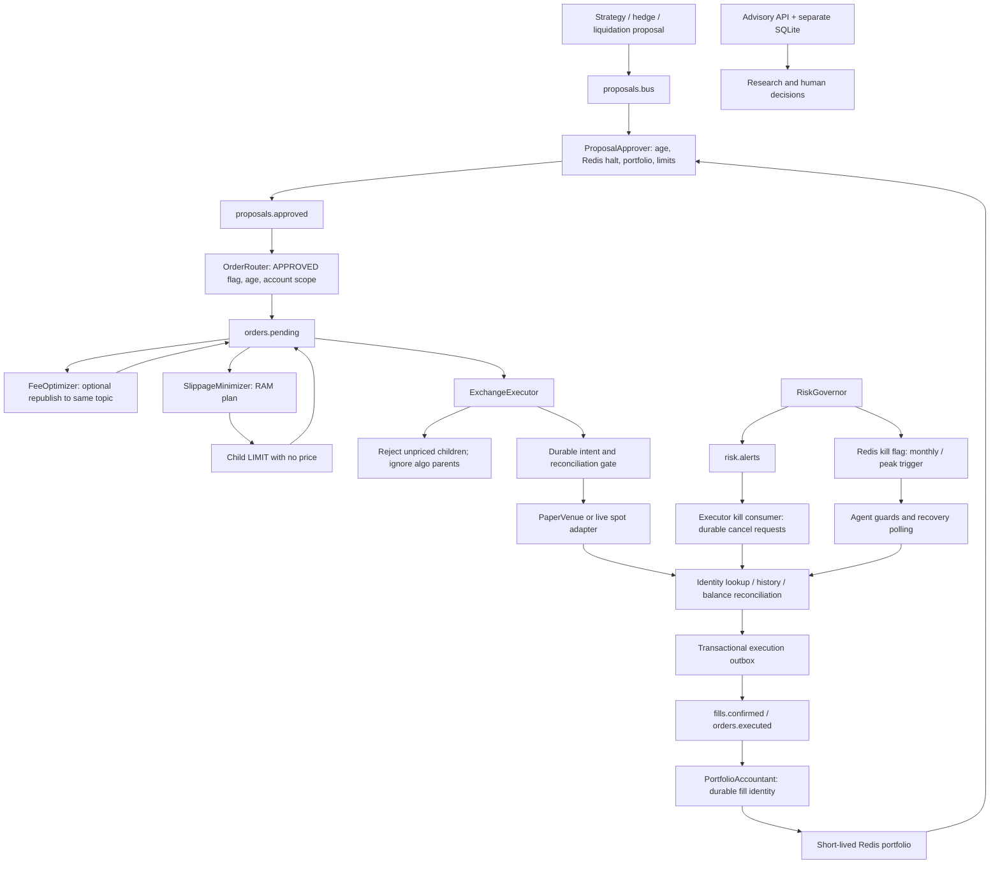

# ALGHREST execution architecture and safety audit

**Date:** 2026-10-23. **Method:** existing Graphify graph, source inspection, and offline mocked checks. **Disposition:** the repository contains a real spot-execution implementation with useful durable recovery controls, but the complete documented pipeline and its safety guarantees are not established. Several concrete gaps must be resolved before treating this architecture as suitable for live execution. This report does not authorize deployment or trading.

## 1. Executive assessment and evidence standard

`KafkaTopic` is a shared vocabulary, not an authorization mechanism or a workflow engine. The verified source path is strategy publication → proposal gateway → router → `orders.pending` → executor → durable intent/recovery → outbox → fills → accountant. Fee optimization and slippage splitting are **independent consumers of the pending-orders topic**, not enforced sequential stages. The TWAP/VWAP branch currently produces children that the executor rejects. Kill handling has a separate Redis/polling path and a Kafka event path; neither creates a distributed atomic fence around an external exchange request.

No advisory-to-live-order bridge was found in the reviewed application import graph or guarded interfaces. Advisory profiles deny order-capable operations even when the environment is set to `live`; the isolated assistant deployment also has no trading environment file or trading-state mount. This is strong source-and-unit-test evidence of isolation, not a proof about an uninspected deployment, modified process, dependency compromise, or future code.

| Major conclusion | Confidence | Evidence and limitation |
|---|---|---|
| The direct MARKET/LIMIT spot path has source-level Kafka wiring and durable order/fill recovery | High, static | Sections 2–4. No real broker, database, exchange, or concurrent service topology was exercised here. |
| The advertised optimizer → splitter → executor sequence is not enforced | High | Separate consumer groups and the same input/output topic; source references in §2. |
| Proposal replay can create fresh executable identities upstream of the durable journal | High | Source plus an offline duplicate-routing probe; actual duplicate exchange execution was not attempted. |
| Weekly halt and daily pause do not implement persistent shared enforcement in the governor | High | Source plus weekly-halt probe. Monthly/25% kill does set the Redis flag. |
| Broker-native stop protection/automatic portfolio flattening is missing from the reviewed execution path | High for this path | Adapter does not pass stop parameters; governor/executor cancel open orders rather than liquidate positions. Other unreviewed integrations cannot be ruled out. |
| Reviewed advisory profiles cannot directly place orders through the guarded execution interfaces | High within reviewed boundary | Architecture and capability tests passed; actual deployed credentials, profile, and network permissions were not inspected. |
| Graph reachability alone cannot establish runtime order flow or advisory reachability | High | Actual false runtime interpretations of test/shared-import paths and two falsely resolved self-loops; §7. |

**Terminology.** “Verified” means inspected source, with a local mocked probe where stated. “EXTRACTED” and “INFERRED” are the graph's original labels, not independent guarantees of correctness. Every graph edge in this run originated from deterministic extraction/resolution; INFERRED does not mean an external AI model was used. Runtime correctness, deployment readiness, strategy edge, and live trading eligibility remain unestablished.

## 2. Verified execution architecture

### 2.1 Flow, including missing links

The advisory branch has **no verified edge** to proposals, pending orders, or exchange mutation. The diagram deliberately does not connect it to the autonomous branch. The feedback arrows represent inspected source contracts, not observed live traffic.

### 2.2 Routing and source evidence

| Stage | Verified behavior | Source |
|---|---|---|
| Vocabulary | `PROPOSALS_BUS`, `PROPOSALS_APPROVED`, `ORDERS_PENDING`, `ORDERS_EXECUTED`, `FILLS_CONFIRMED`, `PORTFOLIO_STATE`, `RISK_ALERTS` are enum values | [models.py:24](/home/xsabo/Projects/MY-project/alghrest-main/src/core/data/models.py:24) |
| Proposal creation | Example `TrendFollower` constructs a MARKET proposal and publishes `PROPOSALS_BUS`; hedge and liquidation components also propose through the gateway | [trend_follower.py:188](/home/xsabo/Projects/MY-project/alghrest-main/src/agents/tier4_strategies/trend_follower.py:188), [hedge_manager.py:123](/home/xsabo/Projects/MY-project/alghrest-main/src/agents/tier5_execution/hedge_manager.py:123), [liquidation_guard.py:133](/home/xsabo/Projects/MY-project/alghrest-main/src/agents/tier5_execution/liquidation_guard.py:133) |
| Approval | Consumes proposals; rejects invalid, terminal-reviewed, halted, stale/future, unverified, or over-limit requests; may reduce quantity and notional | [proposal_approver.py:67](/home/xsabo/Projects/MY-project/alghrest-main/src/agents/tier1_executive/proposal_approver.py:67), [proposal_approver.py:88](/home/xsabo/Projects/MY-project/alghrest-main/src/agents/tier1_executive/proposal_approver.py:88) |
| Approval delivery | Redis review written before publishing `PROPOSALS_APPROVED`; review TTL is 86,400 seconds | [proposal_approver.py:164](/home/xsabo/Projects/MY-project/alghrest-main/src/agents/tier1_executive/proposal_approver.py:164) |
| Routing | Consumes approved topic; requires payload status APPROVED, age −5…60 seconds, and configured account/venue/symbol; creates a new `Order` | [order_router.py:54](/home/xsabo/Projects/MY-project/alghrest-main/src/agents/tier5_execution/order_router.py:54), [order_router.py:74](/home/xsabo/Projects/MY-project/alghrest-main/src/agents/tier5_execution/order_router.py:74) |
| Optimization | Independent `ORDERS_PENDING` consumer; optional MARKET→LIMIT replacement is republished with `_optimised` | [fee_optimizer.py:52](/home/xsabo/Projects/MY-project/alghrest-main/src/agents/tier5_execution/fee_optimizer.py:52) |
| Splitting | Independent pending-order consumer; in-memory plans, random plan/child identities; `_child` avoids recursive splitting | [slippage_minimizer.py:48](/home/xsabo/Projects/MY-project/alghrest-main/src/agents/tier5_execution/slippage_minimizer.py:48), [slippage_minimizer.py:74](/home/xsabo/Projects/MY-project/alghrest-main/src/agents/tier5_execution/slippage_minimizer.py:74) |
| Execution | Earliest-offset, book-specific pending consumer uses `process()`; ignores TWAP/VWAP parents; validates MARKET/LIMIT, freshness, halt/readiness, and durable claim | [exchange_executor.py:80](/home/xsabo/Projects/MY-project/alghrest-main/src/agents/tier5_execution/exchange_executor.py:80), [exchange_executor.py:175](/home/xsabo/Projects/MY-project/alghrest-main/src/agents/tier5_execution/exchange_executor.py:175) |
| Recovery/delivery | Reconcile identities and history, publish outbox, then verify balances/revision/fill settlement; failed or unknown submission is not resent | [recovery.py:42](/home/xsabo/Projects/MY-project/alghrest-main/src/core/execution/recovery.py:42), [recovery.py:137](/home/xsabo/Projects/MY-project/alghrest-main/src/core/execution/recovery.py:137) |
| Accounting | Book-specific earliest fill consumer; durable recording before precise offset commit; fill settlement continues while halted | [portfolio_accountant.py:27](/home/xsabo/Projects/MY-project/alghrest-main/src/agents/tier7_monitoring/portfolio_accountant.py:27), [portfolio_accountant.py:91](/home/xsabo/Projects/MY-project/alghrest-main/src/agents/tier7_monitoring/portfolio_accountant.py:91) |

**Confidence: high for the static stage wiring.** The graph does not itself encode a complete publish-topic-subscribe runtime sequence. Source verification supplied these connections.

### 2.3 Authorization and state transitions

The gateway is an autonomous risk gate, not a human approval/role service. Its review checks previously stored proposal/reviewer IDs; there is no inspected signature binding the approved economics, originating principal, ledger revision, expiry, and eventual child execution identity. Router authorization is a payload APPROVED flag plus age/scope, not a lookup of a gateway permit. Executor authorization is profile capability plus global/readiness/durable account gates, not proof that this exact order was approved. The executor does not require `proposal_id` at all; the schema makes it optional.

Sources: [proposal_approver.py:98](/home/xsabo/Projects/MY-project/alghrest-main/src/agents/tier1_executive/proposal_approver.py:98), [order_router.py:75](/home/xsabo/Projects/MY-project/alghrest-main/src/agents/tier5_execution/order_router.py:75), [models.py:287](/home/xsabo/Projects/MY-project/alghrest-main/src/core/data/models.py:287), [exchange_executor.py:91](/home/xsabo/Projects/MY-project/alghrest-main/src/agents/tier5_execution/exchange_executor.py:91), [store.py:135](/home/xsabo/Projects/MY-project/alghrest-main/src/core/execution/store.py:135).

| Entity | Observed transitions | Important limit |
|---|---|---|
| Proposal/review | Parsed proposal → cached APPROVED or REJECTED; prior terminal review suppresses reprocessing | Redis GET then SET is not an atomic compare-and-set; no durable publication outbox here; cache expiry/loss removes this memory. |
| Routed order | Fresh Order defaults → PENDING payload | `order_id` and `client_order_id` default to new UUIDs on every construction, not a proposal-derived identity. |
| Durable order | Claim → `submitting`; uncertain response → `uncertain`; observation → `working` or `complete`; validation/pre-send abort → `rejected` | No resend of a previously claimed identity. A crash before the network call can remain unresolved and block further risk. |
| Observed venue order | Validated identity, quantities, monotonic filled size, terminal-state constraints | No proof of real venue compatibility was produced here. |
| Cancellation | `cancel_requested=true` persisted before cancel; failures remain available for later recovery | Cancelling open orders does not close filled positions. |

Sources: [models.py:288](/home/xsabo/Projects/MY-project/alghrest-main/src/core/data/models.py:288), [store.py:188](/home/xsabo/Projects/MY-project/alghrest-main/src/core/execution/store.py:188), [store.py:230](/home/xsabo/Projects/MY-project/alghrest-main/src/core/execution/store.py:230), [store.py:264](/home/xsabo/Projects/MY-project/alghrest-main/src/core/execution/store.py:264), [recovery.py:59](/home/xsabo/Projects/MY-project/alghrest-main/src/core/execution/recovery.py:59).

The supplied full Compose stack uses a shared trading principal and SASL_PLAINTEXT on its local trusted-host network; no topic-level authorizer/ACL enforcement was found in that inspected Compose file or topic initializer. Live client configuration refuses this transport and requires SASL_SSL. Therefore “only ProposalApprover can approve” is an application convention, not demonstrated broker-enforced authority. This is conditional on access to a trusted trading writer; it is **not** evidence of unauthenticated remote access or a verified advisory escape. Sources: [docker-compose.yml:3](/home/xsabo/Projects/MY-project/alghrest-main/docker-compose.yml:3), [docker-compose.yml:240](/home/xsabo/Projects/MY-project/alghrest-main/docker-compose.yml:240), [security.py:9](/home/xsabo/Projects/MY-project/alghrest-main/src/core/kafka/security.py:9).

**Confidence: high for the inspected checks/omissions; medium for system-wide authorization conclusions because actual broker ACLs and deployment overlays were not queried.**

## 3. Delivery, idempotency, and recovery guarantees

### 3.1 Kafka delivery

- Producer config uses `acks="all"`, idempotence, and bounded retry. The supplied three-broker config requests replication factor 3 and min ISR 2. This is useful transport protection, not an atomic transaction across Redis, PostgreSQL, Kafka offsets, and the exchange. There is no configured Kafka transaction spanning business processing in the inspected wrapper. [message_bus.py:61](/home/xsabo/Projects/MY-project/alghrest-main/src/core/orchestrator/message_bus.py:61), [message_bus.py:111](/home/xsabo/Projects/MY-project/alghrest-main/src/core/orchestrator/message_bus.py:111), [docker-compose.yml:248](/home/xsabo/Projects/MY-project/alghrest-main/docker-compose.yml:248).
- Default message keys are the source agent ID, not the proposal/order/account identity. Kafka groups are distinct per agent name. Multi-topic emergency/order ordering and a mandatory optimizer sequence do not follow from these keys/groups. [message_bus.py:106](/home/xsabo/Projects/MY-project/alghrest-main/src/core/orchestrator/message_bus.py:106), [message_bus.py:158](/home/xsabo/Projects/MY-project/alghrest-main/src/core/orchestrator/message_bus.py:158), [base_agent.py:195](/home/xsabo/Projects/MY-project/alghrest-main/src/agents/base_agent.py:195).
- `stream()` yields then calls unscoped `commit()`. Approver/router/optimizer/splitter catch handler exceptions and continue, so the wrapper sees a normal yield completion and commits even when handling or output publication failed. Its docstring's Redis dedup claim is not implemented by this stream. An offline probe confirmed commit after a swallowed failure. [message_bus.py:199](/home/xsabo/Projects/MY-project/alghrest-main/src/core/orchestrator/message_bus.py:199), [proposal_approver.py:70](/home/xsabo/Projects/MY-project/alghrest-main/src/agents/tier1_executive/proposal_approver.py:70), [order_router.py:57](/home/xsabo/Projects/MY-project/alghrest-main/src/agents/tier5_execution/order_router.py:57).
- Executor/accountant use the stronger `process()` path: handler failure propagates, then only the processed partition's offset is committed. A crash after durable side effect and before commit can redeliver. Business idempotency still has to handle it. [message_bus.py:223](/home/xsabo/Projects/MY-project/alghrest-main/src/core/orchestrator/message_bus.py:223).
- New upstream consumers default to `latest`; executor/accountant explicitly use `earliest` and book-scoped groups. Existing valid committed offsets take precedence over the reset policy. Bootstrap/new-group upstream history can therefore be skipped. Streams also acknowledge messages skipped during a halt. [base_agent.py:195](/home/xsabo/Projects/MY-project/alghrest-main/src/agents/base_agent.py:195), [exchange_executor.py:175](/home/xsabo/Projects/MY-project/alghrest-main/src/agents/tier5_execution/exchange_executor.py:175).

**Confidence: high for code and mocked wrapper behavior; broker failover/ordering durability remains untested here.**

### 3.2 Durable execution: existing safeguards

`ExecutionStore` takes a PostgreSQL writer advisory lock per book and serializes access to the retained lease connection. Its transactions lock the accounting book row. `prepare()` atomically verifies durable reconciliation revision/expiry, performance revision/age, and account scope, inserts the client identity, and closes the new-risk gate before HTTP. Same-ID replay is suppressed; changed economics under the same ID raises conflict. SQL enforces `(book_id, client_order_id)` uniqueness and venue-order identity uniqueness.

Sources: [store.py:59](/home/xsabo/Projects/MY-project/alghrest-main/src/core/execution/store.py:59), [store.py:135](/home/xsabo/Projects/MY-project/alghrest-main/src/core/execution/store.py:135), [repository.py:88](/home/xsabo/Projects/MY-project/alghrest-main/src/core/accounting/repository.py:88), [002_execution_recovery.sql:12](/home/xsabo/Projects/MY-project/alghrest-main/infra/migrations/002_execution_recovery.sql:12).

There is no automatic create retry on an uncertain exchange response. The record becomes uncertain and recovery looks up by client/venue identity, including closed history where supported; a missing lookup does not permit resubmission. This chooses blocking/reconciliation over duplicate risk. A process that dies after intent commit but before sending can remain blocked indefinitely until an explicit resolution procedure supplies evidence. Sources: [exchange_executor.py:125](/home/xsabo/Projects/MY-project/alghrest-main/src/agents/tier5_execution/exchange_executor.py:125), [ccxt_connector.py:80](/home/xsabo/Projects/MY-project/alghrest-main/src/connectors/exchanges/ccxt_connector.py:80), [exchanges/recovery.py:65](/home/xsabo/Projects/MY-project/alghrest-main/src/connectors/exchanges/recovery.py:65).

Recovered pages and fill outbox events commit in the same DB transaction as the versioned history cursor. Delivery is marked after publish; a crash before marking redelivers. Fill replay uses exchange/account/market/trade identity, not the random envelope/fill UUID. The outbox can republish an already delivered fill if accounting settlement is still missing. The accountant records fill identity and economics under a row lock, detects conflicting replay, and commits its Kafka offset afterward. Sources: [store.py:369](/home/xsabo/Projects/MY-project/alghrest-main/src/core/execution/store.py:369), [store.py:449](/home/xsabo/Projects/MY-project/alghrest-main/src/core/execution/store.py:449), [recovery.py:42](/home/xsabo/Projects/MY-project/alghrest-main/src/core/execution/recovery.py:42), [repository.py:109](/home/xsabo/Projects/MY-project/alghrest-main/src/core/accounting/repository.py:109), [001_accounting.sql:12](/home/xsabo/Projects/MY-project/alghrest-main/infra/migrations/001_accounting.sql:12).

History recovery persists checkpoints, checks repeated cursors, bounds pages per cycle, overlaps prior history, and periodically rescans from opening. Readiness additionally requires history caught up, matching native balances, settled recovered fills, fresh performance, and no open/uncertain journal orders. Unknown venue orders block readiness but are not automatically adopted or cancelled by the journal-only cancellation loop. Sources: [recovery.py:78](/home/xsabo/Projects/MY-project/alghrest-main/src/core/execution/recovery.py:78), [recovery.py:144](/home/xsabo/Projects/MY-project/alghrest-main/src/core/execution/recovery.py:144), [store.py:470](/home/xsabo/Projects/MY-project/alghrest-main/src/core/execution/store.py:470).

**Confidence: high that these protections exist; medium for their complete failure semantics because PostgreSQL/restart suites were inspected but not executed. No exactly-once end-to-end claim is justified.**

### 3.3 Redis consistency and freshness

`trading_ready()` requires the selected book, matching performance/revision, a portfolio snapshot at most 15 seconds old, and a matching ready reconciliation report within the configured 5–60 second ceiling (default 30). Malformed/missing evidence fails closed; infrastructure exceptions propagate rather than become permission. Accountant snapshots use a short 15-second Redis TTL and an accounting row lock; stale valuation or lag invalidates the cache. A DB revision check in `prepare()` protects against relying only on a stale Redis ready flag. Sources: [state_manager.py:103](/home/xsabo/Projects/MY-project/alghrest-main/src/core/orchestrator/state_manager.py:103), [state_manager.py:113](/home/xsabo/Projects/MY-project/alghrest-main/src/core/orchestrator/state_manager.py:113), [performance.py:104](/home/xsabo/Projects/MY-project/alghrest-main/src/core/accounting/performance.py:104), [portfolio_accountant.py:53](/home/xsabo/Projects/MY-project/alghrest-main/src/agents/tier7_monitoring/portfolio_accountant.py:53).

Limits remain: proposal approval does not reserve pending exposure or bind approval to that ledger revision; reviewed proposal IDs use an unnamespaced key and expiring Redis storage; the halt flag's absence means not halted and activation expires after 24 hours. A complete Redis loss normally also removes portfolio/reconciliation evidence and blocks trading, but restoring those caches without the halt can permit resumption. The durable execution gate is not itself a permanent manual halt. Sources: [proposal_approver.py:98](/home/xsabo/Projects/MY-project/alghrest-main/src/agents/tier1_executive/proposal_approver.py:98), [position_limits.py:51](/home/xsabo/Projects/MY-project/alghrest-main/src/core/risk/position_limits.py:51), [state_manager.py:184](/home/xsabo/Projects/MY-project/alghrest-main/src/core/orchestrator/state_manager.py:184).

**Confidence: high for individual guards; distributed consistency under failover remains unverified.**

## 4. Critical safety scenarios and missing safeguards

Priority is remediation order before any proposed live use, not a CVSS rating or a claim of current exploitation.

### F1 — Approval is not an immutable execution permit; replay identity is incomplete (P0)

**Verified facts:** router reconstructs an `Order` on every delivery, with new default order/client UUIDs. The executor's permanent dedup key is client order ID; neither its fingerprint nor claim verifies a gateway approval or cumulative execution for a proposal. `proposal_id` is optional. A synthetic duplicate APPROVED proposal produced two distinct client IDs in the offline probe.

**Failure scenario:** router publishes then crashes before offset commit, or the same approved payload arrives again. After the first trade settles and reconciliation becomes ready again, the second distinct order identity can pass the journal's per-client duplicate check. Freshness and one-order-at-a-time reconciliation reduce the window but do not prove once-per-approved-intent behavior. A trusted trading writer can also construct a direct pending order without a matching approval; the shared broker principal is not a per-stage authorization boundary.

**Evidence:** [order_router.py:106](/home/xsabo/Projects/MY-project/alghrest-main/src/agents/tier5_execution/order_router.py:106), [models.py:287](/home/xsabo/Projects/MY-project/alghrest-main/src/core/data/models.py:287), [store.py:27](/home/xsabo/Projects/MY-project/alghrest-main/src/core/execution/store.py:27), [store.py:135](/home/xsabo/Projects/MY-project/alghrest-main/src/core/execution/store.py:135).

**Improve:** durable approval record/outbox, deterministic proposal-to-order and parent/slice IDs, immutable economics/revision/expiry binding, atomic consumption of permitted quantity, explicit producer authority and topic ACLs. Test replay across router crash and settlement, plus orders without valid permits. **Confidence: high for missing binding and regenerated identity; actual repeated venue execution not tested.**

### F2 — Emergency halt/pause is not consistently durable or shared (P0)

Weekly drawdown invokes `_halt_all_strategies()`, which publishes a Kafka event but does not activate the shared Redis flag. The executor handles the event by blocking reconciliation and cancelling tracked working orders, but the next successful `run_once()` can set readiness true again; `verify()` does not store a persistent halt cause. Strategies and the gateway consult the Redis flag, not this event. The offline probe confirmed no flag activation for an 8% weekly drawdown. Daily pause publishes a recommendation without updating a strategy pause registry. Local BaseStrategy loss counters are a separate mechanism.

Monthly/25% kill does activate Redis first; polling reads that flag and can cancel even if the event publication fails. However the flag has a default 24-hour expiry, and the governor's “already active” return skips a retry of the Kafka publication. The separate `core.risk.kill_switch.KillSwitch` helper sets Redis, but `RiskGovernor` does not instantiate/use it in its inspected runtime implementation. Its presence in the graph must not be substituted for governor behavior.

**Evidence:** [risk_governor.py:107](/home/xsabo/Projects/MY-project/alghrest-main/src/agents/tier1_executive/risk_governor.py:107), [risk_governor.py:129](/home/xsabo/Projects/MY-project/alghrest-main/src/agents/tier1_executive/risk_governor.py:129), [risk_governor.py:238](/home/xsabo/Projects/MY-project/alghrest-main/src/agents/tier1_executive/risk_governor.py:238), [risk_governor.py:263](/home/xsabo/Projects/MY-project/alghrest-main/src/agents/tier1_executive/risk_governor.py:263), [base_agent.py:218](/home/xsabo/Projects/MY-project/alghrest-main/src/agents/base_agent.py:218), [state_manager.py:184](/home/xsabo/Projects/MY-project/alghrest-main/src/core/orchestrator/state_manager.py:184), [recovery.py:137](/home/xsabo/Projects/MY-project/alghrest-main/src/core/execution/recovery.py:137).

**Improve:** one durable halt/pause state machine, explicit human reset, monotonic halt generation, durable event delivery, and readiness that cannot clear a halt. Test weekly/daily enforcement through reconciliation, restarts, expiry, and lost events. **Confidence: high for the omission; system-wide resume behavior is a source-derived scenario, not a live reproduction.**

### F3 — Stop-loss metadata and cancellation are not protective liquidation (P0)

Router copies `stop_loss` to `Order.stop_price`. The live spot adapter sends only symbol, side, size, client ID, and optional limit price. It does not pass stop, bracket/OCO, take-profit, or even order time-in-force/post-only fields. Executor rejects STOP/STOP_LIMIT types. FeeOptimizer's GTX/post-only claim therefore does not imply native maker-only protection. In the inspected TrendFollower, `_close_position()` clears local maps and logs; it does not publish an exit order. This is a verified missing link for that strategy, not a claim about every strategy.

Governor's runtime kill handler and executor recovery cancel outstanding journal orders; they do not submit position-closing orders. The standalone kill helper accepts an optional close callback, but that is not wired into the inspected governor. LiquidationGuard uses a stop-distance proxy instead of actual exchange margin, pauses while halted, and routes closing proposals into the same gateway that rejects everything during a halt.

**Evidence:** [order_router.py:106](/home/xsabo/Projects/MY-project/alghrest-main/src/agents/tier5_execution/order_router.py:106), [exchanges/recovery.py:36](/home/xsabo/Projects/MY-project/alghrest-main/src/connectors/exchanges/recovery.py:36), [ccxt_connector.py:80](/home/xsabo/Projects/MY-project/alghrest-main/src/connectors/exchanges/ccxt_connector.py:80), [trend_follower.py:219](/home/xsabo/Projects/MY-project/alghrest-main/src/agents/tier4_strategies/trend_follower.py:219), [kill_switch.py:145](/home/xsabo/Projects/MY-project/alghrest-main/src/core/risk/kill_switch.py:145), [liquidation_guard.py:58](/home/xsabo/Projects/MY-project/alghrest-main/src/agents/tier5_execution/liquidation_guard.py:58), [liquidation_guard.py:73](/home/xsabo/Projects/MY-project/alghrest-main/src/agents/tier5_execution/liquidation_guard.py:73).

**Improve:** define cancel versus flatten explicitly, prove a reduce-only exit path during halt, preserve account/inventory identity, and verify real broker protection acknowledgment before claiming loss limits. Keep this work disconnected from advisory mode. **Confidence: high for this reviewed path; no exchange API call was made.**

### F4 — Risk checks do not bind executable quantity to approved risk (P0)

PositionLimitChecker rejects nonpositive/nonfinite size/notional and verifies account-specific spot reductions, concentration, leverage, and reserve. Its explicit 1% stop-distance calculation runs only when both stop and limit price are present. MARKET proposals, including TrendFollower's, lack a limit price. There is no inspected invariant proving `size_usd` equals executable units times a trusted current price, or requiring usable protective exit parameters. Clamping a strategy's configured `risk_per_trade` to 1% does not prove the generated/executed order respects that bound. Executor rechecks state but does not recalculate these limits or verify approval-bound quantity.

**Evidence:** [position_limits.py:65](/home/xsabo/Projects/MY-project/alghrest-main/src/core/risk/position_limits.py:65), [position_limits.py:96](/home/xsabo/Projects/MY-project/alghrest-main/src/core/risk/position_limits.py:96), [base_agent.py:264](/home/xsabo/Projects/MY-project/alghrest-main/src/agents/base_agent.py:264), [trend_follower.py:188](/home/xsabo/Projects/MY-project/alghrest-main/src/agents/tier4_strategies/trend_follower.py:188), [exchange_executor.py:98](/home/xsabo/Projects/MY-project/alghrest-main/src/agents/tier5_execution/exchange_executor.py:98).

**Improve:** trusted price/notional/risk validation for MARKET and LIMIT, atomic exposure reservation and revalidation, and a permit bounding cumulative children. Test inconsistent units/notional, absent stops, simultaneous approvals, and market movement between approval and submission. **Confidence: high for missing checks; no quantitative loss estimate or exploit execution claimed.**

### F5 — The algorithmic branch is incomplete, and optimization is a fan-out race (P1)

Router changes notional ≥$5,000 to TWAP. SlippageMinimizer generates LIMIT children with `price=None`; executor rejects exactly that condition. An offline probe confirmed rejection. Plans and slice progress live only in RAM, with new random identities on duplicate parent intake; neither startup recovery nor aggregate execution quantity is persisted. Its execution loop does not check the halt flag before producing a scheduled slice (executor's halt gate remains a second defense).

Optimizer and executor independently see the original and replacement order. A changed optimized request reuses the same client identity, so if optimization actually occurs the execution store can raise a fingerprint conflict depending on arrival order. Normal router MARKET orders have `price=None`, so the optimizer usually does nothing; this conflict is conditional on an eligible priced MARKET input, not an assertion that every routed order races.

**Evidence:** [order_router.py:137](/home/xsabo/Projects/MY-project/alghrest-main/src/agents/tier5_execution/order_router.py:137), [slippage_minimizer.py:88](/home/xsabo/Projects/MY-project/alghrest-main/src/agents/tier5_execution/slippage_minimizer.py:88), [slippage_minimizer.py:106](/home/xsabo/Projects/MY-project/alghrest-main/src/agents/tier5_execution/slippage_minimizer.py:106), [slippage_minimizer.py:124](/home/xsabo/Projects/MY-project/alghrest-main/src/agents/tier5_execution/slippage_minimizer.py:124), [exchange_executor.py:98](/home/xsabo/Projects/MY-project/alghrest-main/src/agents/tier5_execution/exchange_executor.py:98), [fee_optimizer.py:81](/home/xsabo/Projects/MY-project/alghrest-main/src/agents/tier5_execution/fee_optimizer.py:81), [store.py:188](/home/xsabo/Projects/MY-project/alghrest-main/src/core/execution/store.py:188).

**Improve:** either reject/disable unsupported algo requests explicitly or implement a durable parent/slice state machine and mandatory final-order stage. Finalize economics before journaling; do not mutate a claimed identity. **Confidence: high; no complete algorithmic execution path exists in the reviewed implementation.**

### F6 — Approval/publication and stream acknowledgment can lose work (P1)

The review-before-publish ordering suppresses duplicate approvals after uncertain publication, but a crash/failure between Redis SET and Kafka send can leave an APPROVED review with no published order. Redelivery then returns early. Router publication failure is swallowed by its loop; `stream()` subsequently commits. These favor suppression over replay but leave no inspected durable reconciliation/outbox for recovering missing approvals/routed orders. Redis review GET/SET is also not a cross-process atomic claim.

**Evidence:** [proposal_approver.py:174](/home/xsabo/Projects/MY-project/alghrest-main/src/agents/tier1_executive/proposal_approver.py:174), [order_router.py:57](/home/xsabo/Projects/MY-project/alghrest-main/src/agents/tier5_execution/order_router.py:57), [message_bus.py:199](/home/xsabo/Projects/MY-project/alghrest-main/src/core/orchestrator/message_bus.py:199). Existing [test_proposal_approval.py:104](/home/xsabo/Projects/MY-project/alghrest-main/tests/unit/test_proposal_approval.py:104) verifies suppression, not eventual delivery.

**Improve:** transactional durable inbox/outbox through approval and routing, deterministic IDs, explicit retry/dead-letter/quarantine policy, and per-record commits only after durable terminal handling. **Confidence: high for control flow and mocked acknowledgment; broker crash scenario not exercised.**

### F7 — Halt races and infrastructure failures need an explicit emergency contract (P1)

Executor shares an operation lock with order recovery and rechecks Redis halt after durable preparation. These reduce races. They cannot atomically stop an exchange request once the last Redis read completes. A halt can arrive just after the second check, and cancellation waits behind the in-flight submission/recovery lock. A weekly event is weaker still because it never changes Redis halt state. The kill listener requires a valid DB writer and durable block before calling venue cancellation: a PostgreSQL outage can therefore prevent cancellation via this path even when the exchange is reachable.

Recovery records cancellation requests and retries known orders after failures; unknown venue orders only block. Startup kill subscription uses the default latest reset and a group not book-scoped; Redis polling compensates for a missed event only while the shared halt flag exists. Accountant and recovery continue during halt, correctly allowing late fills to settle. No inspected fence spans the final external side effect and an authoritative persistent halt generation.

**Evidence:** [exchange_executor.py:87](/home/xsabo/Projects/MY-project/alghrest-main/src/agents/tier5_execution/exchange_executor.py:87), [exchange_executor.py:127](/home/xsabo/Projects/MY-project/alghrest-main/src/agents/tier5_execution/exchange_executor.py:127), [exchange_executor.py:160](/home/xsabo/Projects/MY-project/alghrest-main/src/agents/tier5_execution/exchange_executor.py:160), [recovery.py:53](/home/xsabo/Projects/MY-project/alghrest-main/src/core/execution/recovery.py:53), [portfolio_accountant.py:91](/home/xsabo/Projects/MY-project/alghrest-main/src/agents/tier7_monitoring/portfolio_accountant.py:91).

**Improve:** define permitted in-flight behavior, persistent halt epochs and post-submit compensating checks, bounded emergency cancellation with a reviewed DB-outage procedure, scoped durable event replay, and tests controlling every await boundary around submit/halt/cancel. **Confidence: high for dependency/order of checks; timing/outage outcomes are scenarios requiring controlled integration validation.**

## 5. Advisory approval versus live execution

The manual assistant assembles `AdvisoryStore`, public-data HTTP client, `AdvisoryService`, optional restricted intelligence consumer, and routes returning research/risk decisions. The optional consumer subscribes only to five intelligence topics and persists bounded fields into advisory SQLite. It is not an order producer. Advisory decisions are not `TradeProposalStatus.APPROVED` permits.

`Settings.require_order_execution()` permits only the `general` operating profile. Both Earn2Trade profiles deny BaseAgent startup/publication, Kafka producer startup/send/raw-send, executor initialization/submission, spot adapter mutation, and connector placement/cancellation. `is_live` is an additional environment condition at the real connector. Setting `ENVIRONMENT=live` by itself therefore does not unlock those advisory profiles.

The import checker traverses local transitive imports, package initializers, literal dynamic imports, and forbidden producer/exchange/state interfaces, with narrow inert-schema exceptions. It passed the reviewed source and deliberate-violation unit cases in this run. The assistant Compose definition explicitly uses an advisory profile, mounts only research SQLite storage, has no `env_file`, and disables the optional Kafka tap.

Sources: [advisor.py:56](/home/xsabo/Projects/MY-project/alghrest-main/src/api/advisor.py:56), [advisor.py:361](/home/xsabo/Projects/MY-project/alghrest-main/src/api/advisor.py:361), [intelligence.py:15](/home/xsabo/Projects/MY-project/alghrest-main/src/connectors/advisory/intelligence.py:15), [intelligence.py:92](/home/xsabo/Projects/MY-project/alghrest-main/src/connectors/advisory/intelligence.py:92), [config.py:200](/home/xsabo/Projects/MY-project/alghrest-main/src/core/config.py:200), [base_agent.py:176](/home/xsabo/Projects/MY-project/alghrest-main/src/agents/base_agent.py:176), [docker-compose.advisor.yml:4](/home/xsabo/Projects/MY-project/alghrest-main/docker-compose.advisor.yml:4), [check_architecture.py:19](/home/xsabo/Projects/MY-project/alghrest-main/scripts/check_architecture.py:19), [check_architecture.py:148](/home/xsabo/Projects/MY-project/alghrest-main/scripts/check_architecture.py:148).

**Answer:** no direct advisory approval → live order route was found or demonstrated in the reviewed boundary. This conclusion must not be stretched into “no code in this repository can trade”: the general-profile autonomous path deliberately can call real exchange APIs when `live`, credentials, scope, and state gates permit. Actual runtime profile, ACLs, secrets, and running services were not inspected. **Confidence: high within reviewed code/test scope; deployed isolation is unknown.**

## 6. Real integrations, mocks, simulations, and scope

| Component | What exists | What this audit does not establish |
|---|---|---|
| Live executor | CCXT Pro spot path for Binance, Bybit, Coinbase, Kraken; client IDs and venue-specific recovery/history code | API-version compatibility, entitlement, permissions, market constraints, real cancellation/fill latency, or successful authenticated operation |
| Development/paper executor | Persistent simulated `PaperVenue`, separate DB-backed orders/balances/fills, mark-based matching and synthetic fees | Live matching, slippage/partial fills/queue priority, real broker failure semantics |
| `test_execution_pipeline.py` | Actual agent objects, finite mock streams, mocked store/venue/producer, sequential dispatch | Concurrent independent consumer groups, real Kafka, migrations, or exchange execution |
| `test_execution_recovery.py` | Opt-in PostgreSQL transactions plus simulated venue, restart/identity/history cases | Real exchange crash recovery; it was not run here |
| `test_paper_runtime.py` | Opt-in real local Kafka/PG/Redis, unique synthetic book/topics, replay check; hand-controlled component dispatch | Full production topology or broker-leader failover; it was not run here |
| Dashboard mock server | Random/synthetic dev feed | Evidence that agents, risk controls, or an exchange are operational |
| Tier 6 | Source explicitly labels mock/skeleton logic; settings default disabled | Production DeFi capability |
| Futures/TCP25/TCP50 research | Advisory/research types and simulation communities | An execution connector for MES/MNQ or a funded-program authorization path; execution AccountScope is spot BASE/QUOTE only |

Sources: [exchange_executor.py:46](/home/xsabo/Projects/MY-project/alghrest-main/src/agents/tier5_execution/exchange_executor.py:46), [paper.py:104](/home/xsabo/Projects/MY-project/alghrest-main/src/connectors/exchanges/paper.py:104), [contracts.py:23](/home/xsabo/Projects/MY-project/alghrest-main/src/core/execution/contracts.py:23), [accounting/models.py:27](/home/xsabo/Projects/MY-project/alghrest-main/src/core/accounting/models.py:27), [test_execution_pipeline.py:1](/home/xsabo/Projects/MY-project/alghrest-main/tests/integration/test_execution_pipeline.py:1), [test_execution_recovery.py:62](/home/xsabo/Projects/MY-project/alghrest-main/tests/integration/test_execution_recovery.py:62), [test_paper_runtime.py:40](/home/xsabo/Projects/MY-project/alghrest-main/tests/integration/test_paper_runtime.py:40), [mock_server.py:1](/home/xsabo/Projects/MY-project/alghrest-main/src/api/mock_server.py:1), [config.py:48](/home/xsabo/Projects/MY-project/alghrest-main/src/core/config.py:48), [yield_farmer.py:42](/home/xsabo/Projects/MY-project/alghrest-main/src/agents/tier6_defi/yield_farmer.py:42).

The cross-exchange strategy publishes independent buy/sell proposals, not an atomic two-leg execution transaction; the spot gateway requires inventory for sells. Do not interpret its strategy name as proof of hedged, synchronized leg settlement. [arb_cross_exchange.py:154](/home/xsabo/Projects/MY-project/alghrest-main/src/agents/tier4_strategies/arb_cross_exchange.py:154), [position_limits.py:67](/home/xsabo/Projects/MY-project/alghrest-main/src/core/risk/position_limits.py:67). **Confidence: high for implementation classification; runtime integration status unknown.**

## 7. Graph investigation and integrity impact

### 7.1 What the graph actually establishes

Existing graph: **5,569 nodes, 17,598 edges, undirected, non-multigraph**. Edge labels: **15,378 EXTRACTED; 2,220 INFERRED**. All 410 original input hashes still matched the initial build during this audit; the graph was not stale for those captured files. Files outside the initial corpus, notably scripts/topic initialization and SQL bodies lacking parsers, required direct follow-up inspection.

Query vocabulary selected from existing labels: `kafka topic proposal approver execution recovery risk kill switch state order advisory`. The offline CLI query at budget 2,000 found 722 nodes and returned 55, explicitly truncating 667. Exact-name node inspection and scoped paths were used afterward; the truncated answer was not treated as complete coverage.

| Actual graph relationship/path | Original confidence | Audit interpretation |
|---|---|---|
| `KafkaTopic —uses— ProposalApprover`, source approver line 68 | INFERRED | Source verifies consumption of `PROPOSALS_BUS`; the graph's generic uses edge does not express delivery. |
| `ExchangeExecutor —uses— ExecutionStore`, executor line 36 | INFERRED | Type annotation is real; source initialization at lines 48–52 verifies construction/use. |
| `ProposalApprover — test_happy_path_execution — OrderRouter` | Two EXTRACTED calls, test lines 116 and 135 | Test orchestration, not a production direct call or communication channel. |
| `OrderRouter — test_happy_path_execution — ExchangeExecutor` | Two EXTRACTED calls, test lines 135 and 149 | Same limitation; source topic subscriptions must establish the real route. |
| `RiskGovernor — RiskMetrics — KillSwitch` | INFERRED type-use edges | Shared data type; does not prove the governor calls the standalone helper. It does not do so in the inspected implementation. |
| `KillSwitch — TestKillSwitchPerformance — Order — ExchangeExecutor` | INFERRED uses | A test/type bridge, not an emergency-delivery chain. |
| `AdvisoryService — advisor.py — asyncio — exchange_executor.py — ExchangeExecutor` | EXTRACTED imports/contains | Shared standard-library dependency in an undirected graph. It is not an advisory execution capability. |

Sources for critical locations are supplied in §§2–5. The source direction and the relation meaning override any undirected shortest-path appearance. No new relationships were inserted into the preserved graph.

### 7.2 The 1,617 raw dangling-endpoint edges

Raw extraction has 5,400 unique node IDs and 18,352 edges; diagnostic candidate-edge definitions differ from final builder normalization. Its missing endpoint breakdown is **816 imports_from, 562 imports, 305 calls**, totaling 1,683 edges with undefined endpoints. The diagnostic classifies **66 external `ref_*` edges separately**, leaving the reported **1,617 dangling**. Common missing labels include `pytest`, `asyncio`, `datetime`, `typing`, `json`, `decimal`, and `pydantic`.

The final builder normalized/materialized references and exported 5,569 nodes with **zero dangling endpoints**. This does not prove that every raw reference became the intended symbol. Examples affecting this audit include unresolved imports in message_bus (12 raw edges), state_manager (8), execution/store (7), and recovery (5). Shared dependency hubs can create misleading cross-module paths, as demonstrated above. Thus the count is not evidence that 1,617 application calls are absent, nor is final endpoint validity evidence of architectural correctness. **Confidence: high for counts/classification; semantic recovery of every raw edge was not exhaustively verified.**

### 7.3 The 749 collapsing endpoint pairs

Diagnostics report 743 directed and 749 undirected same-endpoint collapse excess edges across 718 grouped endpoint sets; 612 groups vary by relation and 54 by source location. In a simple graph, multiple imports/calls/references between the same symbols cannot remain independent parallel edges. Opposite directions can also share one undirected pair.

This affects conclusions about which relation, call site, direction, or dependency count connects safety components. It does not erase the inspected Python statements. Use the preserved raw `extraction.json` for parallel evidence and source for routing/authorization; do not interpret degree or one surviving relation as a complete dependency inventory. Example groups include advisory API construction/type-reference edges and duplicate import/re-export relations. **Confidence: high; the graph was not rebuilt or converted to a multigraph.**

### 7.4 The five self-loops

| Self-loop source | Source verification | Effect |
|---|---|---|
| `dashboard/src/i18n/core.ts:58` | `translateText` recursively translates split list parts | Real recursion; unrelated to execution safety |
| `src/connectors/advisory/briefing_store.py:95` | `self.check()` recurses once with an explicit DB connection | Real control flow; not a trading recursion |
| `tests/unit/test_evaluation_policy.py:725` | Nested `walk()` recursively transforms test structures | Real test recursion |
| `src/core/accounting/models.py:72` | `LedgerPosition.key` calls module-level `key(*parts)` at line 23, not itself | **False self-call resolution**; do not infer recursive accounting failure |
| `src/core/execution/contracts.py:40` | `AccountScope.key` calls imported module-level `key`, not itself | **False self-call resolution**; directly affects recovery/account-identity graph interpretation |

All five carry EXTRACTED confidence in the raw graph, demonstrating that this label cannot replace source verification. Sources: [i18n/core.ts:58](/home/xsabo/Projects/MY-project/alghrest-main/dashboard/src/i18n/core.ts:58), [briefing_store.py:95](/home/xsabo/Projects/MY-project/alghrest-main/src/connectors/advisory/briefing_store.py:95), [test_evaluation_policy.py:725](/home/xsabo/Projects/MY-project/alghrest-main/tests/unit/test_evaluation_policy.py:725), [accounting/models.py:23](/home/xsabo/Projects/MY-project/alghrest-main/src/core/accounting/models.py:23), [accounting/models.py:72](/home/xsabo/Projects/MY-project/alghrest-main/src/core/accounting/models.py:72), [contracts.py:40](/home/xsabo/Projects/MY-project/alghrest-main/src/core/execution/contracts.py:40). **Confidence: high.**

### 7.5 Missing SQL/Terraform parsers and unmodeled safety links

Five SQL and two Terraform files contributed no native graph extraction because optional parsers were absent. The critical accounting and execution migration files were read directly during this audit, verifying primary keys, order phases, outbox uniqueness, and durable simulation tables. Missing parser coverage therefore no longer blocks those specific schema conclusions, but applied migrations/database constraints were not verified on a running DB. Terraform was not audited; no production infrastructure conclusion is supported by its file presence.

Other missing/ambiguous graph links include broker ACLs, actual topic configuration, durable DB constraints, dynamic venue protocol behavior, Redis/Kafka/DB transaction boundaries, error/timeout behavior, and temporal order across independent consumers. These require source/configuration/runtime evidence rather than more undirected reachability. The initial graph's YAML representation was only a top-level key inventory. **Confidence: high for coverage limits; deployed infrastructure state unknown.**

## 8. Tests, validation performed, and gaps

### 8.1 Executed safely in this audit

**420 existing tests passed, 110 warnings, in 1.92 seconds.** Selected files:

- `tests/unit/test_architecture.py`
- `tests/unit/test_advisory_capabilities.py`
- `tests/unit/test_proposal_approval.py`
- `tests/unit/test_exchange_executor.py`
- `tests/unit/test_execution_adapters.py`
- `tests/unit/test_kill_switch_cancel.py`
- `tests/unit/test_risk_behavior.py`
- `tests/integration/test_kafka_messaging.py`
- `tests/integration/test_execution_pipeline.py`

Tests were run with the existing `.venv`, plugin autoload disabled, explicit pytest-asyncio plugin, repository addopts overridden for a focused diagnostic run, bytecode/cache writes disabled, and temporary files under `/tmp`. There was **no coverage measurement or global 70% gate result**. The two integration-labelled files use mocked I/O, as their docstrings explicitly state. The warnings are predominantly existing naive-UTC deprecations, not failures.

The launcher cleared inherited environment values, ran from `/tmp` so project `.env` was not loaded, explicitly selected development/general defaults, and blocked socket connections/DNS. Tests exercising `live` guards used mocks. **Network attempts: 0.** No service was started, restarted, configured, or queried; no real order/cancel occurred. The first pytest invocation failed at option parsing because disabling plugin autoload also disabled coverage options; the corrected focused invocation overrode addopts and passed. No dependency was added or test requirement weakened.

Four additional temporary probes, with production functions and mocked state/transport, passed:

| Probe | Observation | Bound |
|---|---|---|
| Route identical approval twice | Two different `client_order_id` values | Does not place either order |
| Create TWAP slice then call executor boundary | LIMIT child has no price and is rejected | Does not require DB or venue |
| Apply 8% weekly drawdown | `HaltAllStrategies` published; shared halt activation not called | Does not simulate subsequent real recovery |
| Swallow a handler exception inside `stream()` iteration | Commit is called | Uses an in-memory transport double |

The temporary harness and log were `/tmp/alghrest_audit_checks.py` and `/tmp/alghrest-audit-checks.log`; they are not application changes or persistent infrastructure. **Confidence: high for these limited outcomes.**

### 8.2 Existing coverage that was inspected

| Safety area | Existing tests | Unverified gap |
|---|---|---|
| Approval size/freshness and terminal review suppression | [test_proposal_approval.py:38](/home/xsabo/Projects/MY-project/alghrest-main/tests/unit/test_proposal_approval.py:38), [test_proposal_approval.py:104](/home/xsabo/Projects/MY-project/alghrest-main/tests/unit/test_proposal_approval.py:104) | Durable eventual publication, concurrent approval claims, router crash/replay and once-per-proposal quantity |
| Execution validation/uncertain create | [test_exchange_executor.py:79](/home/xsabo/Projects/MY-project/alghrest-main/tests/unit/test_exchange_executor.py:79), [test_exchange_executor.py:96](/home/xsabo/Projects/MY-project/alghrest-main/tests/unit/test_exchange_executor.py:96) | Real venue acceptance, approval proof, final-check/halt timing |
| Pagination/client identity/live guard | [test_execution_adapters.py:57](/home/xsabo/Projects/MY-project/alghrest-main/tests/unit/test_execution_adapters.py:57), [test_execution_adapters.py:198](/home/xsabo/Projects/MY-project/alghrest-main/tests/unit/test_execution_adapters.py:198) | Real API contract, exchange restart, time-in-force/stop protection |
| Kill dispatch | [test_kill_switch_cancel.py:13](/home/xsabo/Projects/MY-project/alghrest-main/tests/unit/test_kill_switch_cancel.py:13) | Weekly persistent halt, DB outage cancellation, unknown venue orders, flattening |
| Governor thresholds | [test_risk_behavior.py:79](/home/xsabo/Projects/MY-project/alghrest-main/tests/unit/test_risk_behavior.py:79) | Weekly test checks event publication, not persistent shared latch; daily test checks alert, not enforced pause |
| Durable identity/restart/cursor/fill settlement | [test_execution_recovery.py:137](/home/xsabo/Projects/MY-project/alghrest-main/tests/integration/test_execution_recovery.py:137), [test_execution_recovery.py:187](/home/xsabo/Projects/MY-project/alghrest-main/tests/integration/test_execution_recovery.py:187), [test_execution_recovery.py:282](/home/xsabo/Projects/MY-project/alghrest-main/tests/integration/test_execution_recovery.py:282) | Opt-in PostgreSQL suite not run; simulated venue only |
| Real Kafka fill replay | [test_paper_runtime.py:40](/home/xsabo/Projects/MY-project/alghrest-main/tests/integration/test_paper_runtime.py:40) | Not run; controlled dispatch and unique one-partition smoke topics do not cover full fan-out or broker-leader failover |
| Advisory boundary | [test_architecture.py:19](/home/xsabo/Projects/MY-project/alghrest-main/tests/unit/test_architecture.py:19), [test_advisory_capabilities.py:65](/home/xsabo/Projects/MY-project/alghrest-main/tests/unit/test_advisory_capabilities.py:65) | Actual deployed profiles, independent broker ACLs, startup/background behavior under every deployment configuration |

Passing existing tests does not negate F1–F7: several assertions test individual components or intentionally mocked ordering, not the missing end-to-end invariant.

## 9. Prioritized improvements and acceptance evidence

No improvement below was implemented. Each requires its own approved implementation scope and safe test plan.

| Priority | Work | Minimum acceptance evidence |
|---|---|---|
| **P0** | Bind durable approval authority/economics to deterministic order/slice identities and cumulative quantity (F1/F4) | Replayed approved event before/after restart and settlement cannot create additional permitted exposure; forged/mismatched permit rejected before venue contact |
| **P0** | Unify persistent halt/pause enforcement and explicit reset (F2) | Weekly/daily events, lost publication, Redis loss/restore, reconciliation success, restart, and elapsed 24h never silently clear an active halt |
| **P0** | Define and implement protective stops and emergency close semantics, independently of advisory mode (F3) | Mock contract then isolated paper tests prove reductions/stop handling, account identity, partial fills, and post-halt exits; actual broker protection requires separately authorized environment validation |
| **P1** | Replace same-topic mutation with an explicit final-order boundary and durable algo plans (F5) | Original/replacement cannot race into execution; valid priced children, stable IDs, bounded aggregate quantity, halt-aware scheduling, and restart recovery |
| **P1** | Durable inbox/outbox through proposal approval and routing; explicit commit/retry policy (F6) | Failure injection before/after each state write/publication/commit produces either one terminal outcome or an auditable blocked intent, not lost approval or duplicate order |
| **P1** | Document and test halt-vs-submit race, DB/broker failure cancellation and operator resolution (F7) | Controlled await-boundary tests plus separately authorized isolated PG/Kafka restart tests; explicit no-resend resolution for pre-HTTP ambiguous claims |
| **P1** | Per-service authenticated producer authority and correct live transport | Topic ACL/permit tests deny inappropriate writes; review a live-compatible TLS overlay without changing production infrastructure in this audit |
| **P2** | Improve the graph's evidence model | Preserve directions and parallel relations; distinguish tests/import hubs/runtime entities; repair global-function/property name resolution; add source-backed topic/SQL relation inventories without changing this preserved graph |
| **P2** | Make operational scope and simulations explicit | Report supported spot venues/types, algo rejection, cancel-versus-flatten, research/futures limitations, and mock status consistently; test independent arbitrage-leg failure semantics |

## 10. Graphify usefulness, measurement, and preservation

- The graph quickly located approval, execution store, recovery, risk, messaging, and relevant test nodes. It also exposed where shared imports/tests create misleading paths. Source verification was essential for all safety conclusions.
- Initial extraction metrics, read from existing artifacts: **17.438 seconds**, **0 input LLM tokens**, **0 output LLM tokens**, **0 external AI API calls**. This audit performed **no extraction/rebuild or external AI API call**.
- The prior local benchmark records 295,463 corpus words, an estimated 393,950 full-corpus tokens, and approximately 1,605 tokens per budgeted sample query (245.5× smaller text). These are heuristic text-size estimates, not billed tokens, measured reasoning savings, or proof of complete retrieval. The broad query in this audit was visibly truncated, so that reduction is not a completeness claim.
- Actual total tokens used by the conversational audit, source review, and report generation are **not exposed by the available tooling**. They are not reported as zero. Only deterministic Graphify extraction/API usage is zero.
- Graph staleness check: all 410 captured input hashes matched. Existing Graphify files were fingerprinted before review and checked after report creation. The graph, original report, raw extraction, diagnostics, manifests, metrics, and other substantive artifacts remained unchanged. The Graphify CLI query updated only its existing `cache/last_query_stamp` access-timestamp content; its previous content was not captured for restoration. This metadata side effect is an exception to byte-for-byte preservation of every cache file. No graph update, graph repair, HTML generation, memory/reflection write, application modification, dependency installation, live trading, or production infrastructure operation was performed.
- Existing evidence is preserved under `graphify-out/runs/local-ast-20261023T020517Z/`, especially `extraction.json`, `diagnostics.json`, `metrics.json`, `benchmark.json`, and `input-hashes.json`. The only intended new repository deliverable is this audit report.

## 11. Practical conclusion

`KafkaTopic` connects these components through shared schemas and named publish/consume contracts. It does not enforce who may approve, prevent a router from issuing a fresh identity on replay, make optimizer consumers sequential, persist a weekly halt, attach protective stop orders, or guarantee atomic cancellation against an exchange.

The durable executor/accountant design is materially stronger than the upstream approval/routing path: permanent intent identity, row-locked claims, revision/freshness gates, no uncertain-create resend, transactional fill outbox, and durable fill deduplication are present. The missing links above prevent a verified end-to-end safety claim. Advisory isolation has positive current source/test evidence and should remain intact. Runtime correctness, production readiness, broker recovery, and permission to execute remain outside what this audit established.
